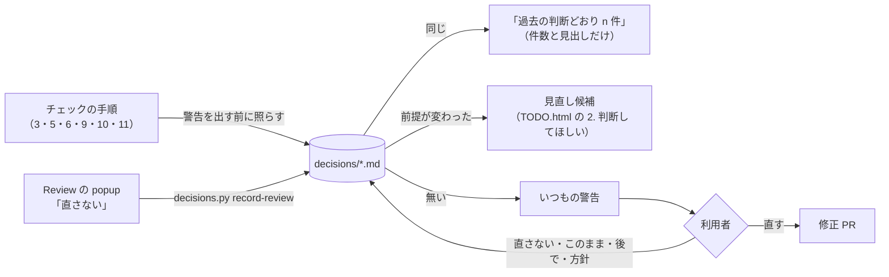

# 過去の判断（decisions/）

リリース前チェックで出た指摘に、利用者が下した判断（直さない・このまま・後で・方針）を溜める場所。
次のチェックはここを読み、**同じ指摘を警告や TODO として出し直さない**。利用者に同じことを二度聞かないためにある。



## ファイル

| ファイル | 中身 | 読む手順 |
|---|---|---|
| `docs.md` | docs・README・手順書の文言・例への指摘（手順 2・5・6・11） | 5・6・11 |
| `api.md` | 公開範囲・API の形・非推奨の時期（手順 3・4） | 3・4 |
| `install.md` | インストールキット・katachi コマンドの振る舞い（手順 9） | 9 |
| `ide-plugin.md` | IDE プラグイン（手順 10） | 10 |
| `environment.md` | 既知の環境要因（クラウド・Remote Control・root で走らせたときにだけ落ちるもの） | 8・9・10 |
| `process.md` | チェックの進め方そのものの決まり（どこで何を回すか、何はこの場でしないか） | オーケストレータ |

どれにも合わないものは、いちばん近いファイルに書く。ファイルを増やしたら上の表にも足す。

## 1 件の形

Review の指摘（`docs/src/integrations/feedback/review/README.md`）と同じ形にしてある。popup の「直さない」をそのまま写せて、
照合も `file` と `quote` でできる。

```md
## 直さない: 指示語「これらは」
- decision: 直さない
- file: ja/get-started/comparison-with-other-tools.mdx
- quote: これらは **katachi と排他的とは限りません**
- rule: D3-3（「これら」ではなく指すものを書く）
- decided: 2026-11-10 261109-01 KATACHI-333
- by: 利用者（Review の popup）

元の指摘の要約と、利用者の一言（理由）。理由が無ければ「理由の一言なし」と書く。
```

- 見出しは `## <decision>: <指摘の見出し>`。見出しは元の指摘の見出しをそのまま使う（照合に使う）。優先度の `[pN]` は付けない（判断は優先度と関係なく効く）。
- 見出しの直後に続く `- key: value` だけがメタ。空行のあとは本文（Markdown）。

| キー | 中身 |
|---|---|
| `decision` | 必須。下の 4 つのどれか |
| `file` | 指摘の場所。リポジトリ直下からのパス。docs の本文は `docs/src/content/docs/` を省いて `ja/…mdx` と書いてよい。`*` と `**` のグロブが使える（`方針` で「get-started の全ページ」など）。場所の無い判断（`process.md` など）は省く |
| `quote` | その場所に含まれる文字列。照合と「まだ残っているか」の確かめに使う。`…` は省略とみなす |
| `match` | `方針` で使う。指摘の見出しの正規表現（例: `目的の?コメント`）。`file` のグロブに該当し、見出しがこれに合う指摘は同じとみなす。回ごとに見出しの言い方が揺れる種類の指摘をまとめて外すため |
| `rule` | 破っているとされたルール（手順 11 のチェック項目の番号と要約など）。番号は回ごとに振り直されるので、要約も書く |
| `decided` | 必須。判断した日（JST）・prerelease の回・チケット番号 |
| `by` | 判断した人と場所（「利用者（TODO.html）」「利用者（Review の popup）」「利用者（チャット）」） |
| `revisit` | `後で` は必須、ほかは任意。見直す条件（「PR #65 のマージ後」「v0.5 の CLI の刷新」など）。条件が満たされたら、次のチェックで見直し候補にする |

### decision の 4 つ

| decision | 意味 | 次のチェックでの扱い |
|---|---|---|
| `直さない` | 指摘は分かったうえで、この箇所は直さない | 同じ箇所・同じ指摘は出さない |
| `このまま` | 今の設計・挙動・公開範囲が意図どおり | 同じ宣言・同じ挙動への指摘は出さない |
| `後で` | 今回は直さない。`revisit` の条件で見直す | 条件が満たされていなければ出さない。満たされていれば見直し候補 |
| `方針` | ある種類の指摘をまとめて扱う決まり（「get-started の断片の例には summary を求めない」など） | `file` のグロブと本文の条件に該当する指摘は出さない |

`方針` は利用者がそう言ったときだけ書く。`直さない` が同じ形で何件も続いても、エージェントが勝手に `方針` にまとめない
（まとめてよいかを TODO.html の「判断してほしい」で聞く）。

## 照らし方（チェックの手順で）

1. チェックを始める前に `python3 .claude/skills/prerelease/scripts/decisions.py check` を回す（1 の `prepare.py` も同じものを出す）。
   - `ERROR`（形の誤り）は直す。
   - `GONE`（ファイルが無い）は、対象ごと消えたので判断も消す。
   - `LOST`（`quote` が見つからない）は、箇所が書き換わった。その手順の結果に同じ趣旨の指摘が出なければ判断を消し、
     出たら「見直し候補」にする。どちらにしたかを結果に書く。
   - `REVISIT`（`revisit` の付いた判断）は、条件を満たしたかを見る。満たしていれば「見直し候補」。
2. 各手順（subagent に任せるならその subagent）に、上の表の「読む手順」のファイルを渡す。
3. 指摘が判断と**同じ**とは: `file` が同じ（グロブに該当する）で、見出しが同じ、または `quote` が重なり見出しも似ている、
   または見出しが `match` に合う（`decisions.py match` の `SAME`）。`quote` だけ重なって見出しが違うもの（`NEAR`）は、同じ箇所の別の指摘かもしれないので
   外さずに中身を読んで決める。`このまま` の API は、同じ宣言（名前と所属）を指していれば同じ。`方針` は本文の条件で判断する。
4. 同じなら警告にしない。結果の末尾に「過去の判断どおり（n 件）」として、判断の見出しだけを `<details>` に並べる。
5. 同じ箇所だが**前提が変わった**とき（`revisit` が満たされた、指摘の中身が判断のときより重い、箇所が書き換わって判断が
   合わない）は、警告にせず「見直し候補」として出す。TODO.html の「2. 判断してほしい」に、前の判断と一緒に載せる。
6. 手順 11 の指摘を Review に登録するときは、登録する前に `decisions.py match <review.md> --drop` で同じものを外す。

## 書き足し方

- 利用者が TODO.html やチャットで「直さない」「このまま」「後で」「こういう方針で」と答えたら、**その回のうちに**ここへ書く。
  修正 PR があればそこに入れ、無ければ記録だけの PR を出す。チケットの「決定済み」の 1 行と同じ内容にする。
- Review の popup で「直さない」になった指摘は、`review remove` の前に写す。
  人が popup に足した選択肢のうち `- decision:` の付いたもの（`<置き場>/review/_actions.md`。Review の README の「選択肢を足す」）で解決済みにした指摘も、
  同じコマンドがその decision で写す（「後で」はひとことを `revisit` にする。ひとことが無ければ「次の prerelease で人に聞く」）。

  ```shell
  python3 .claude/skills/prerelease/scripts/decisions.py record-review <置き場>/review/<名前>.md \
    --decided "2026-11-10 261109-01 KATACHI-333"
  # 写した指摘の id が消す順（後ろから）に出る → 出た順に node docs/src/integrations/feedback/server/cli.mjs review remove <id>
  # （同じ見出しの指摘は x・x-2 と id が振られ、x を先に消すと x-2 が x にずれるので、出た順を守る）
  ```

  同じ見出し・同じ `file` の判断が既にあれば写さない（何度回してもよい）。`match` の付いた `方針` に合う指摘も写さない（id だけ出す）。
- 判断を覆すとき（「やっぱり直す」）は、その判断を消す。履歴は git に残る。
- 消した・書き換えた判断も、書き足した判断と同じ PR に入れる。
