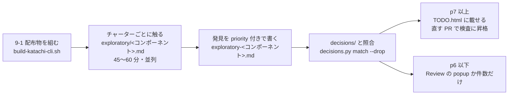

# 13. 探索的検証

[SKILL.md](../SKILL.md) の手順 13 の詳細。ほかの手順は「決めた物差しを全件に当てる」検査型だが、13 は**利用者の目線で、手順書にない触り方をして問題を探す**。
CI・スクリプトが通ったあとに「触って」見つかった不具合（261110 の p9・261119 の p10 = KATACHI-363 の再発）を、リリース前に拾うために足した（KATACHI-402）。
nightly（週替わり）で回す版は [exploratory-nightly.md](exploratory-nightly.md)。



## 検査型との違い

| | 検査型（1〜12） | 探索的検証（13） |
|---|---|---|
| 決めるもの | 物差しと手順。全件に当てる | 利用者像と観点（チャーター）だけ。手順は決めない |
| 見つかるもの | 既知の形の崩れ・漏れ | 黙って通る・メッセージが不親切・既定の設定で動かない |
| 弱み | 想定していない使い方は見ない | 毎回同じ結果にならない |

弱みを抑えるため、**再現手順が書けないものは発見に数えない**。件数の増減でチェックの良し悪しを判断しない。
9-2（手順書どおりに導入する統合テスト）は skill と導入の探索にあたる。13 の「skill」のチャーターは 9-2 に統合してあり、別には回さない。

## チャーター

置き場は [exploratory/](exploratory/)（コンポーネントごとに 1 ファイル）。`python3 .claude/skills/prerelease/scripts/exploratory.py list` で一覧と書式の検査が出る。

| ファイル | コンポーネント | 場所 | 目安 | 回す人 |
|---|---|---|---|---|
| `core.md` | core/DSL・検査 | クラウド | 60 分 | subagent |
| `konsist-konture.md` | konsist・konture | クラウド | 45 分 | subagent |
| `gradle-plugin.md` | Gradle plugin | クラウド（AGP を使うものは Mac） | 60 分 | subagent |
| `cli-script.md` | CLI・script | クラウド | 45 分 | subagent |
| `diff.md` | core/katachiDiff・Actions | クラウド（Actions は GitHub 上） | 45 分 | subagent |
| `docs.md` | docs | クラウド | 45 分 | subagent |
| `ide-plugin.md` | IDE plugin（IDEA・Android Studio） | Mac のみ | 人 15 分 | 利用者（AI は環境と観点カードを用意） |

sample（Android・iOS）は既存の確認のまま。**新しいコンポーネントを `.github/labels.json` に足したら、チャーターも足す**（手順 12 の対応表と同じ。CONTRIBUTING のコンポーネント表と突き合わせる）。

チャーターの書式（`exploratory.py lint` が見る）:

- `# チャーター: <名前>` の見出し。続けて `- 利用者像:` `- 場所:` `- 目安:` の 3 行
- `## 観点` … 触り方の型（下の共通の観点から選び、このコンポーネント向けに言い換える）
- `## 入口` … 使ってよい入口（配布物）と、使ってはいけない近道
- `## やってみること` … 手順ではなく「こういう場面を作ってみる」の例。**例にない操作を最低 3 つ試す**（手順書に引きずられないため）
- `## 過去に見つかったもの` … 同じ型の発見があれば 1 行ずつ（チケット番号つき）。無ければ「なし」

### 共通の観点（ツアー）

- 初めて: README と入門だけを頼りに、最短で動かす
- 移行: v0.3 から上げる。移行表（リリースノートの BREAKING）どおりに直す
- わざと間違える: 打ち間違い・指定漏れ・順序違い・存在しないものを渡す
- 既定のまま: 設定を足さない。既定で動くか（363 型の発見）
- 環境違い: Gradle・Kotlin・OS・日本語 IDE の違い

## 入口と並べ方

- 入口は**利用者と同じ配布物だけ**: 9-1 の `build-katachi-cli.sh` が組む `bin/katachi`・mavenLocal に publish した katachi・6-1 で配信しているビルド済み docs。
  リポジトリの `build/` を使わないので、SKILL.md の「Gradle を使う作業は同時に 1 つ」と重ならず、9-2 と並列にできる。
  各セッションは自分の作業ディレクトリ（`.local/release-v<版>/tmp/exploratory/<コンポーネント>/`）で、プロジェクトの**写し**を触る
- 9-1 が終わってから始める（配布物が要る）。クラウドの 6 つは並列。全体の待ちはおよそ +1 時間
- 触ってはいけないもの: katachi のリポジトリの `git add/commit/push/stash/checkout/restore/clean`、`.local/sample-app/` の原本、4321 番（利用者の astro dev）、本番のサイトへの書き込み
- 本物のコード（`katachi/`・`katachi-script/`・`docs/`）は直さず、見つけたものを報告する
- 環境は 9-2 と同じ（[install-kit-e2e-brief.md](install-kit-e2e-brief.md) の「katachi コマンド」「配信元」「やってはいけないこと」）。クラウドで届かないもの・環境要因は [decisions/environment.md](../decisions/environment.md)

## 出力の形

`.local/release-v<版>/exploratory-<コンポーネント>.md`。ログ・生データは `tmp/exploratory/<コンポーネント>/`。

````md
# 探索的検証: <コンポーネント>

- チャーター: exploratory/<コンポーネント>.md
- かかった時間: 52 分
- 入口: bin/katachi 0.4.0・mavenLocal の katachi 0.4.0

# やったこと

1. （時系列で 10 行以内。何を試して何が起きたか）

# 発見

## [p7] cli-script: 存在しないファイルを渡すと黙って成功する
- file: exploratory:cli-script
- quote: （エラーメッセージや出力の文面。decisions/ と照合するのに使う）
- impact: あり（利用者が詰まる）

再現手順（コピーして動く形）・利用者の困りごと・直し方の案。

# 触れなかったところ

- 時間が足りなくて見なかったもの

# 次回の観点

- 次に触るとよいもの
````

- 発見 1 件は 1 つの `## [pN] <コンポーネント>: <症状>`（Review の指摘と同じ形）。priority の基準は 9-2 と同じ
  （9〜10 書いたとおりにすると失敗し原因にたどり着けない・検査が黙って効かない / 7〜8 失敗するがメッセージから直せる / 5〜6 失敗しないが誤った理解・余計な作業 / 3〜4 迷う・遠回り / 1〜2 言い回し）
- `file:` は `exploratory:<チャーターの名前>`（実在しない目印。decisions.py の判断と照合するため。置き場所のあるものは実際のパスでよい）
- 「発見」の見出しは `## ` を使い、それ以外の区切りは `# ` にする（`decisions.py` は `## ` だけを指摘として読む）

## 発見の流し先

1. 書き終えたら `python3 .claude/skills/prerelease/scripts/decisions.py match .local/release-v<版>/exploratory-<コンポーネント>.md --drop` で、過去の判断と同じものを外す
   （外した分は結果の末尾の「過去の判断どおり」に見出しだけ並べる。`NEAR` は外さず中身を読んで決める）
2. p7 以上: TODO.html の「1. リリース前に直すか決める」に載せる。**方針が明らかなものは聞かずに直す PR を出す**（利用者の指示 2026-11-11）。
   直す PR で、再現を検査（9-1 の fixture・`uiTest`・各 spec）に足す（探索を検査へ昇格させる。足せない理由があれば PR に書く）
3. p6 以下の docs・文言: Review の popup に登録する（`impact`・`recommend` を付ける。[docs-rules.md](docs-rules.md) の「Review に登録する」）
4. そのほかの p6 以下: index.html に件数だけ。本文は `exploratory-<コンポーネント>.md`
5. 利用者が「直さない」「このまま」「後で」と答えたら、その回のうちに decisions/ に書き足す。`file` は `exploratory:<チャーターの名前>`、`quote` に文面

## IDE plugin（人が触る回）

実 IDE のウィンドウと画面を使い、Mac の画面ロックで中断した実績がある（261119-01 の 10-5）ので、AI が画面を操作して回すのは、13 を 1〜2 回回して効果を見てから考える。
当面は次の形にする。

1. AI が環境を用意する: 10-2・10-5 の `run-ide-plugin-e2e.py` と同じ要領で、今回の版のプラグインを入れた IDEA と Android Studio、`sample/jvm` の写し（Android Studio は既定の設定のまま）
2. `exploratory/ide-plugin.md` の「やってみること」から、その版で変わった箇所に関係する観点を 5 つ選び、TODO.html の「4. 操作してほしい」に「観点カード」として載せる
3. 利用者が 15 分ほど触り、気づいたことを一言で返す（形は問わない）。AI が発見の形に書き起こし、同じ流し先に流す

## 効果の測り方

13 を回した回ごとに、チェックリストの 13 に次を書く。nightly に進む判断（[exploratory-nightly.md](exploratory-nightly.md)）の材料にする。

- 発見の件数（p7 以上 / p6 以下）。再現手順が無くて捨てた件数
- 検査に昇格できた件数
- 1 セッションあたりの時間

p7 以上が毎回 1 件以上出るなら効いている。ほぼ 0 件なら、チャーターを見直すか頻度を下げる。
