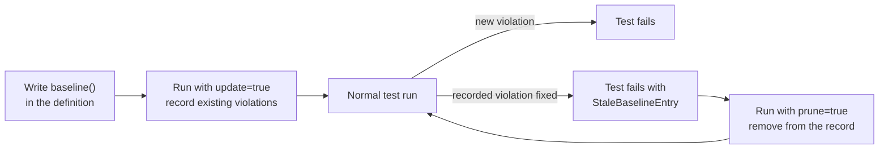

import { CardGrid, LinkCard } from '@astrojs/starlight/components';

{/*
  The purpose of this page: to gain a deep, comprehensive understanding of the baseline feature, which is useful when introducing katachi into an existing project.
  */}

Adding katachi to an existing project means that on the first run, **undeclared files and directories come out as violations.** The basic approach is to work through the reported paths one by one — adding them to the definition, moving them, or deleting them — but when there are a lot of them, you can't clear them all right away.

baseline is a feature that temporarily suppresses existing violations, so that new violations fail the test.

The diagram below shows the whole flow of using baseline. You write `baseline()` in the definition and record the existing violations with `update`. After that, once you fix a violation, you remove it from the record with `prune`.



Figure 1. The baseline flow. Recorded violations don't fail the test; only new violations and records left behind after a fix do

## Setting it up

### 1. Write `baseline()` in the definition

Add `baseline()` to the `architecture { }` in `ProjectArchitecture.kt`.

```kt title="ProjectArchitecture.kt (excerpt)" {3}
val projectArchitecture: Architecture = architecture {
  // ...
  baseline()

  // ...
}
```

When you set baseline, by default the project root's `katachi-baseline.json` is used as the baseline file.

### 2. Declare the baseline file itself with `layout { }`

The baseline file is also one of the project's files, so unless it's declared as a role, `projectArchitecture.assert()` will error out.

Following convention, prepare a role named `"BaselineFile"` and add it to your architecture definition.

```kt
val projectArchitecture = architecture {
  // ...
  "Tool".group {
    "Katachi".group {
      baselineFile()
    }
  }

  // ...
}

fun DeclarationContainerScope.baselineFile() = "BaselineFile".role {
  title = "katachi Baseline file"
  summary = "A file for temporarily suppressing existing violations"
  description = "See: https://tbsten.github.io/katachi/guides/baseline/"
  layout {
    "katachi-baseline.json".file()
  }
}
```

### 3. Create the baseline file

Running the architecture test with `-Dkatachi.baseline.update=true` makes all violations pass instead of erroring, and writes them into the baseline file.

```shell
./gradlew :architecture-test:test -Dkatachi.baseline.update=true
```

It's recommended to commit the created/updated file.

Violations of [`ktFileContent { }`](/katachi/0.3/guides/kt-file-content/) are recorded per declaration. Examples of the unit are `GetUserUseCaseImpl`, `HomeViewModel.isLoading`, `import android.content.Context`, or `package com.example.home`. Line numbers are not recorded, so even if you add lines to the same file and the violating line shifts, the violations you tolerated stay tolerated. (AI draft)

Violations tolerated by the baseline not only do not fail the test; they are also not written to the SARIF report (`report { sarif = true }`).

## After you fix a tolerated violation

When you fix a violation that had been tolerated, the baseline file is left with a record of a violation that no longer exists. If left alone, a different file placed at the same path later would pass silently. For that reason katachi reports these leftovers as `[StaleBaselineEntry]` and **fails the test.**

To remove fixed violations from the baseline file, run the architecture test again with `-Dkatachi.baseline.prune=true`.

```shell
./gradlew :architecture-test:test -Dkatachi.baseline.prune=true
```

prune only **reduces** the number of records. It never adds new violations to the baseline file (that is the job of `-Dkatachi.baseline.update=true`). Commit the baseline file again once its violations have gone down.

## Summary

This is a complete example that puts the setup above together.

```kt
// Record:  ./gradlew :architecture-test:test -Dkatachi.baseline.update=true
// Remove:  ./gradlew :architecture-test:test -Dkatachi.baseline.prune=true
val projectArchitecture = architecture {
  baseline()

  "BaselineFile".role {
    summary = "A file that temporarily suppresses existing violations"
    layout {
      "katachi-baseline.json".file()
    }
  }
}
```

## Next steps

<CardGrid>
  <LinkCard title="Your first architecture definition" href="/katachi/get-started/first-architecture/" description="How to write your first definition, before tolerating any existing violations with a baseline." />

  <LinkCard title="Role" href="/katachi/guides/role/" description="Learn how to write a Role's description, placement, and constraints together, as in the baseline file's Role." />

  <LinkCard title="Layout" href="/katachi/guides/layout/" description="Learn how to write placements so that files in undeclared locations become violations." />

  <LinkCard title="katachi-baseline.json in sample/jvm" href="https://github.com/TBSten/katachi/blob/main/sample/jvm/katachi-baseline.json" description="The recorded violations. The reason each one is left in on purpose is written in a comment in the source." />
</CardGrid>
