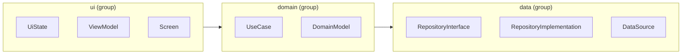

{/*
  The purpose of this page: to show, in a copy-and-paste form, how to declare the UI, domain, and data layers of the official Android app architecture guide with Roles and groups, and check conventions down to naming and content.
  */}

import SnippetIsStartingPoint from '../../../../components/SnippetIsStartingPoint.astro';

import { Aside, FileTree, LinkCard, TabItem, Tabs } from '@astrojs/starlight/components';

This page shows an example that declares the UI, domain, and data layers as groups and the kinds of files as Roles, and checks naming and contents as well.

<LinkCard title="App Architecture Guide" description="Android's official recommended architecture: the roles of the UI, domain, and data layers, and the direction of their dependencies." href="https://developer.android.com/topic/architecture" />

The app architecture guide published by Android Developers is widely known as the baseline architecture for Android applications.

Below is an example architecture definition for a setup that adopts a domain layer.



Figure 1. The groups of the three layers and the Roles in them. Arrows show the direction of dependencies

## Example directory structure

<FileTree>
  * app/src/main/kotlin/com/example/project/
    * ui/
      * home/
        * HomeUiState.kt
        * HomeViewModel.kt
        * HomeScreen.kt
    * domain/
      * user/
        * GetUserUseCase.kt
      * model/
        * User.kt
    * data/
      * user/
        * UserRepository.kt
        * UserRepositoryImpl.kt
        * UserRemoteDataSource.kt
</FileTree>

## Architecture definition

Put the groups of the three layers in `ProjectArchitecture.kt`, and one file per Role under `roles/`.

```kt title=ProjectArchitecture.kt nocollapse
@file:OptIn(ExperimentalKatachiApi::class)

import me.tbsten.katachi.ExperimentalKatachiApi
import me.tbsten.katachi.dsl.architecture
import me.tbsten.katachi.dsl.gradle.gradle

/**
 * See https://developer.android.com/topic/architecture
 */
val projectArchitecture = architecture {
  gradle() // Gradle files such as the wrapper, settings and build scripts

  // https://developer.android.com/topic/architecture/ui-layer
  "ui".group {
    uiState()
    viewModel()
    screen()
  }

  // https://developer.android.com/topic/architecture/domain-layer
  "domain".group {
    useCase()
    domainModel()
  }

  // https://developer.android.com/topic/architecture/data-layer
  "data".group {
    repositoryInterface()
    repositoryImplementation()
    dataSource()
  }
}
```

```kt title=Constants.kt
const val appPackageDir = "com/example/project"
```

<Tabs>
  <TabItem label="UiState">
    ```kt title=roles/UiState.kt
    @file:OptIn(ExperimentalKatachiApi::class)

    import me.tbsten.katachi.ExperimentalKatachiApi
    import me.tbsten.katachi.dsl.DeclarationContainerScope
    import me.tbsten.katachi.dsl.RoleScope
    import me.tbsten.katachi.dsl.gradle.kotlin
    import me.tbsten.katachi.dsl.gradle.mainSourceSet
    import me.tbsten.katachi.dsl.kotlin.ktFile
    import me.tbsten.katachi.konsist.konsist

    fun DeclarationContainerScope.uiState() = "UiState".role {
      summary = "Holds the state a screen renders, as an immutable value"
      layout {
        "app" / mainSourceSet / kotlin / appPackageDir / "ui/*" / "*UiState".ktFile()
      }

      shouldBeImmutable()
    }

    private fun RoleScope.shouldBeImmutable() =
      "All properties are val".konsist {
        classes().must { klass -> klass.properties().all { it.isVal } }
      }
    ```
  </TabItem>

  <TabItem label="ViewModel">
    ```kt title=roles/ViewModel.kt
    @file:OptIn(ExperimentalKatachiApi::class)

    import me.tbsten.katachi.ExperimentalKatachiApi
    import me.tbsten.katachi.dsl.DeclarationContainerScope
    import me.tbsten.katachi.dsl.gradle.kotlin
    import me.tbsten.katachi.dsl.gradle.mainSourceSet
    import me.tbsten.katachi.dsl.kotlin.ktFile
    import me.tbsten.katachi.konsist.declarations.ktFileContent

    fun DeclarationContainerScope.viewModel() = "ViewModel".role {
      summary = "Exposes a screen's state as a StateFlow and receives events from the screen"
      layout {
        "app" / mainSourceSet / kotlin / appPackageDir / "ui/*" / "*ViewModel".ktFile()
      }

      // HomeViewModel.kt contains only class HomeViewModel, which extends ViewModel
      ktFileContent {
        `package`(matchingDirectory)
        `import`("**")

        required(`class`, fileName).superclass("ViewModel") {
          required(public, `val`, "uiState", "StateFlow<${fileName.replace("ViewModel", "UiState")}>")
          allow(public, `fun`, "*")          // events from the screen
          allow(private, anythingElse)     // UseCases, and the writable side of the state
        }
      }
    }
    ```
  </TabItem>

  <TabItem label="Screen">
    ```kt title=roles/Screen.kt
    @file:OptIn(ExperimentalKatachiApi::class)

    import me.tbsten.katachi.ExperimentalKatachiApi
    import me.tbsten.katachi.dsl.DeclarationContainerScope
    import me.tbsten.katachi.dsl.gradle.kotlin
    import me.tbsten.katachi.dsl.gradle.mainSourceSet
    import me.tbsten.katachi.dsl.kotlin.ktFile
    import me.tbsten.katachi.konsist.declarations.ktFileContent

    fun DeclarationContainerScope.screen() = "Screen".role {
      summary = "The public Composable that draws a screen"
      layout {
        "app" / mainSourceSet / kotlin / appPackageDir / "ui/*" / "*Screen".ktFile()
      }

      // The only public declaration in HomeScreen.kt is @Composable fun HomeScreen
      ktFileContent {
        `package`(matchingDirectory)
        `import`("**")

        required(annotated("Composable"), public, `fun`, fileName)
        allow(private, anythingElse)      // anything private is fine, such as parts of the screen and Previews
      }
    }
    ```
  </TabItem>

  <TabItem label="UseCase">
    ```kt title=roles/UseCase.kt
    @file:OptIn(ExperimentalKatachiApi::class)

    import me.tbsten.katachi.ExperimentalKatachiApi
    import me.tbsten.katachi.dsl.DeclarationContainerScope
    import me.tbsten.katachi.dsl.gradle.kotlin
    import me.tbsten.katachi.dsl.gradle.mainSourceSet
    import me.tbsten.katachi.dsl.kotlin.ktFile
    import me.tbsten.katachi.konsist.declarations.ktFileContent

    fun DeclarationContainerScope.useCase() = "UseCase".role {
      summary = "Runs one app-specific behavior through invoke"
      layout {
        "app" / mainSourceSet / kotlin / appPackageDir / "domain/*" / "*UseCase".ktFile()
      }

      // GetUserUseCase.kt contains only class GetUserUseCase, and its only public function is invoke
      ktFileContent {
        `package`(matchingDirectory)      // the package that matches the directory
        `import`("**")

        required(`class`, fileName) {
          required(public, suspend.optional(), operator, `fun`, "invoke")  // it may or may not be suspend
          allow(private, anythingElse)      // such as the Repository received in the constructor
        }
      }
    }
    ```
  </TabItem>

  <TabItem label="DomainModel">
    ```kt title=roles/DomainModel.kt
    @file:OptIn(ExperimentalKatachiApi::class)

    import me.tbsten.katachi.ExperimentalKatachiApi
    import me.tbsten.katachi.dsl.DeclarationContainerScope
    import me.tbsten.katachi.dsl.gradle.kotlin
    import me.tbsten.katachi.dsl.gradle.mainSourceSet
    import me.tbsten.katachi.dsl.kotlin.ktFile

    fun DeclarationContainerScope.domainModel() = "DomainModel".role {
      summary = "Models that represent the app's concepts in the domain layer"
      layout {
        "app" / mainSourceSet / kotlin / appPackageDir / "domain/model" / "*".ktFile()
      }
    }
    ```
  </TabItem>

  <TabItem label="RepositoryInterface">
    ```kt title=roles/RepositoryInterface.kt
    @file:OptIn(ExperimentalKatachiApi::class)

    import me.tbsten.katachi.ExperimentalKatachiApi
    import me.tbsten.katachi.dsl.DeclarationContainerScope
    import me.tbsten.katachi.dsl.gradle.kotlin
    import me.tbsten.katachi.dsl.gradle.mainSourceSet
    import me.tbsten.katachi.dsl.kotlin.ktFile
    import me.tbsten.katachi.konsist.declarations.ktFileContent

    fun DeclarationContainerScope.repositoryInterface() = "RepositoryInterface".role {
      summary = "The interface that serves as the entry point for reading and storing data"
      layout {
        "app" / mainSourceSet / kotlin / appPackageDir / "data/*" / "*Repository".ktFile()
      }

      // UserRepository.kt contains only interface UserRepository
      ktFileContent {
        `package`(matchingDirectory)
        `import`("**")

        required(`interface`, fileName) {
          allow(anythingElse)      // any members
        }
      }
    }
    ```
  </TabItem>

  <TabItem label="RepositoryImplementation">
    ```kt title=roles/RepositoryImplementation.kt
    @file:OptIn(ExperimentalKatachiApi::class)

    import me.tbsten.katachi.ExperimentalKatachiApi
    import me.tbsten.katachi.dsl.DeclarationContainerScope
    import me.tbsten.katachi.dsl.gradle.kotlin
    import me.tbsten.katachi.dsl.gradle.mainSourceSet
    import me.tbsten.katachi.dsl.kotlin.ktFile
    import me.tbsten.katachi.konsist.declarations.ktFileContent

    fun DeclarationContainerScope.repositoryImplementation() = "RepositoryImplementation".role {
      summary = "The implementation of RepositoryInterface"
      layout {
        "app" / mainSourceSet / kotlin / appPackageDir / "data/*" / "*RepositoryImpl".ktFile()
      }

      // UserRepositoryImpl.kt contains only class UserRepositoryImpl, which implements UserRepository
      ktFileContent {
        `package`(matchingDirectory)
        `import`("**")

        required(`class`, fileName).superclass(fileName.removeSuffix("Impl")) {
          allow(anythingElse)      // any members
        }
      }
    }
    ```
  </TabItem>

  <TabItem label="DataSource">
    ```kt title=roles/DataSource.kt
    @file:OptIn(ExperimentalKatachiApi::class)

    import me.tbsten.katachi.ExperimentalKatachiApi
    import me.tbsten.katachi.dsl.DeclarationContainerScope
    import me.tbsten.katachi.dsl.gradle.kotlin
    import me.tbsten.katachi.dsl.gradle.mainSourceSet
    import me.tbsten.katachi.dsl.kotlin.ktFile
    import me.tbsten.katachi.konsist.declarations.ktFileContent

    fun DeclarationContainerScope.dataSource() = "DataSource".role {
      summary = "Access to the sources and stores of data that a Repository uses"
      layout {
        "app" / mainSourceSet / kotlin / appPackageDir / "data/*" / "*DataSource".ktFile()
      }

      // UserRemoteDataSource.kt contains only class UserRemoteDataSource
      ktFileContent {
        `package`(matchingDirectory)
        `import`("**")

        required(`class`, fileName) {
          allow(anythingElse)      // any members
        }
      }
    }
    ```
  </TabItem>
</Tabs>

A real definition that splits the layers into groups and the kinds of files into Roles is in [ProjectArchitecture.kt in sample/android](https://github.com/TBSten/katachi/blob/main/sample/android/architecture-test/src/test/kotlin/com/example/sample/ProjectArchitecture.kt). The sample has no domain layer and splits its modules by screen, so its definition is shaped differently from the one on this page.

When you use `ktFileContent { }` and `konsist { }`, you need the setup described in [Define an allow list of the declarations a file may contain](/katachi/0.3/guides/kt-file-content/#installation).

## AndroidManifest.xml and the res/ Role

Android files that belong to none of the three layers also need Roles. `:app` has only one `AndroidManifest.xml`, so write its name as it is. The layout inside `res/` is decided by the Android resource system, so use `ignore()` for it. The next two are quoted from [AndroidManifestRole.kt](https://github.com/TBSten/katachi/blob/main/sample/android/architecture-test/src/test/kotlin/com/example/sample/roles/AndroidManifestRole.kt) and [AndroidResourceRole.kt](https://github.com/TBSten/katachi/blob/main/sample/android/architecture-test/src/test/kotlin/com/example/sample/roles/AndroidResourceRole.kt) in sample/android.

```kt {8,20}
// roles/AndroidManifest.kt
import me.tbsten.katachi.dsl.DeclarationContainerScope
import me.tbsten.katachi.dsl.gradle.mainSourceSet

fun DeclarationContainerScope.androidManifest() = "AndroidManifest".role {
  summary = "The :app AndroidManifest.xml that declares the app to Android"
  layout {
    "app" / mainSourceSet / "AndroidManifest.xml".file()
  }
}

// roles/AndroidResource.kt
import me.tbsten.katachi.dsl.DeclarationContainerScope
import me.tbsten.katachi.dsl.gradle.mainSourceSet

fun DeclarationContainerScope.androidResource() = "AndroidResource".role {
  summary = "res/ of :app. The Android resource system decides its inner layout"
  layout {
    // AGP checks the arrangement of values/ and drawable-*/, so katachi does not look at it
    "app" / mainSourceSet / "res".ignore()
  }
}
```

In `ProjectArchitecture.kt`, put them into the `:app` group, as in `"app".group { androidManifest(); androidResource() }`. The sample also places the `MainActivity` and `MainApplication` Roles in the same group ([AppGroup.kt](https://github.com/TBSten/katachi/blob/main/sample/android/architecture-test/src/test/kotlin/com/example/sample/groups/AppGroup.kt)).

<SnippetIsStartingPoint>
  For example, if your product uses Dagger Hilt, you might add a check for the `@HiltViewModel` annotation on ViewModels, or a check that repository implementation classes have an `@Inject` constructor — customizations like these will likely be necessary.
</SnippetIsStartingPoint>
