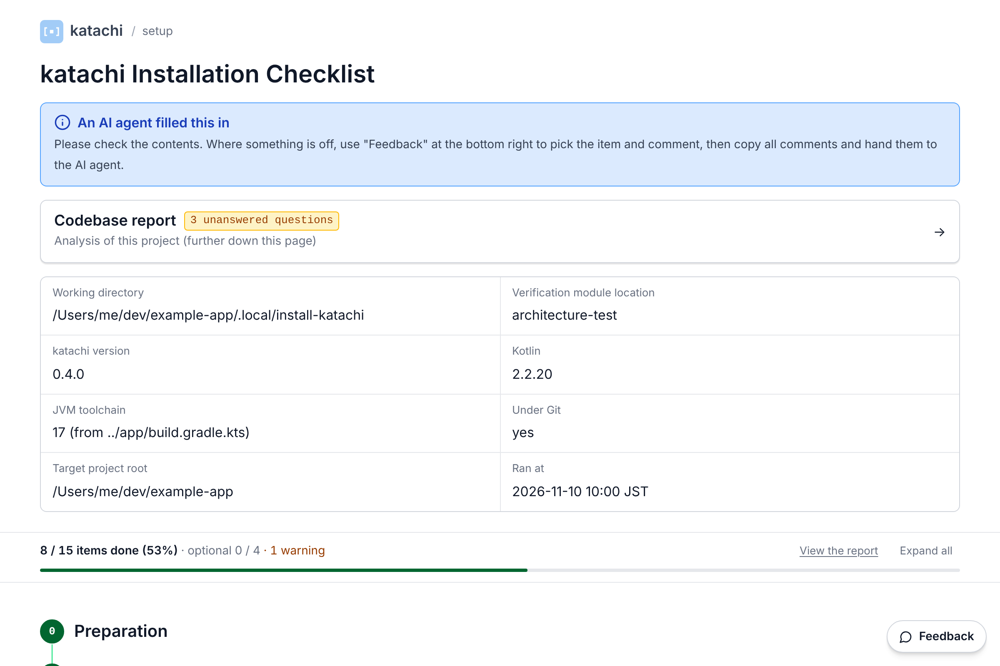

{/*
  Purpose of this page: to let a user who understands katachi's motivation add katachi to their own project. That includes configuring the Gradle module and the surrounding setup.
*/}

import { Aside, Tabs, TabItem, Steps, Badge, CardGrid, LinkCard } from '@astrojs/starlight/components';

This page walks you through using an AI Agent to add katachi to a Gradle project, write your first `architecture { }` definition, and get the test to pass.

If you are not yet convinced that you need katachi, read [Motivation](/katachi/get-started/motivation/) first.

## Add katachi to your project with an AI Agent

To add katachi and get the test to pass, you have to identify every kind of file that exists in the project.
The larger the project you add katachi to, the harder this work gets.

So let an AI Agent take care of it. katachi provides a CLI and an Agent Skill that support an AI Agent driven setup of katachi.

If you need to install it manually, see [Manual install](/katachi/get-started/manual-install/).

### 1. Install the katachi CLI and the Agent Skill

You can install the CLI with Homebrew as follows.

```shell
brew install tbsten/tap/katachi
```

You can install the Agent Skill with gh skills or npx skills.

<Tabs>
  <TabItem label="gh skills">
    ```shell
    gh skill install TBSten/katachi katachi
    ```
  </TabItem>

  <TabItem label="npx skills">
    ```shell
    npx skills add TBSten/katachi --skill katachi
    ```
  </TabItem>
</Tabs>

---

<details>
<summary>Additional options</summary>

- **Git**

  Putting the project under Git beforehand is recommended.

- **Additional documentation**

  If your architecture documentation lives outside the codebase (in Notion, for example), prepare a link to it and make sure the AI Agent can access it.

- **Module and other structure**

  By default the AI Agent creates an `architecture-test` module and writes the architecture definition there. To use a different module, add a prompt such as `Create the test in <module>`.

- **Session**

  As a matter of context hygiene, we recommend starting a fresh session dedicated to setting up katachi. For Claude Code or Codex CLI, clear the session with `/clear`, then enter the prompt.

</details>

### 2. Tell the AI Agent to collect your project's architecture

```md
Set up katachi in this project.
```

When it receives the prompt, the Agent follows the katachi Agent Skill and collects information about the project.

The information the Agent collects is written to an HTML file called the installation checklist, so review whether its contents match the architecture your project is meant to have.



- The installation checklist may list the points the AI Agent was unsure about **as questions**. Enter your answers by following the form.
- Start **feedback mode** from the floating button at the bottom right to write pinpoint comments on anything that concerns you or on the architecture.
- Once you enter one or more answers, a floating menu appears. Press the copy button in the floating menu and hand your answers back to the AI Agent.

<details>
  <summary>An example of the installation checklist</summary>

  <iframe
    src="/katachi/install/en/check-list-sample.html"
    title="An example of the installation checklist"
    loading="lazy"
    style="width: 100%; height: 40rem; border: 1px solid var(--sl-color-gray-5); border-radius: 0.5rem;"
  ></iframe>

  [Open the example installation checklist in a new tab](/katachi/install/en/check-list-sample.html)

</details>

### 3. Review the architecture definition

Once the AI Agent has generated the architecture definition, review it and consider carefully whether it is something you can take into your project.

What to look at:

- [ ] **`architecture-test/src/test/kotlin/<package>/ProjectArchitecture.kt`** is the entry point. Starting there, check that each Role it calls is declared the way your project considers correct.
- [ ] If you work in a team, have your **teammates (especially the team lead) review it closely** as well.


## Wire it into CI (optional)

To keep the quality up, run the katachi architecture test regularly by wiring it into CI.

<Tabs>
    <TabItem label="GitHub Actions">
        Add a workflow file like this one.

        ```yaml nocollapse title=".github/workflows/architecture.yml"
        name: Architecture

        on:
          push:
            branches: [main]
          pull_request:

        permissions:
          contents: read

        jobs:
          architecture:
            runs-on: ubuntu-latest
            steps:
              - uses: actions/checkout@v7

              - uses: actions/setup-java@v6
                with:
                  distribution: temurin
                  java-version: '17'

              - uses: gradle/actions/setup-gradle@v6

              - run: ./gradlew :architecture-test:test
        ```

    </TabItem>

    <TabItem label="Other CI systems">
        Describe a workflow like the following, in whatever form your CI system expects.

        1. Set up Java.
        2. Run `./gradlew :architecture-test:test`.
        3. Report the result of step 2.
    </TabItem>
</Tabs>

## Next steps

<CardGrid>
  <LinkCard
    title="Basic API"
    href="/katachi/guides/basic-api/"
    description="Learn the APIs you pick up first when writing a katachi definition."
  />
  <LinkCard
    title="Role"
    href="/katachi/guides/role/"
    description="Learn how to write a Role, the basic unit of a definition, and how to think about splitting them."
  />
  <LinkCard
    title="Layout"
    href="/katachi/guides/layout/"
    description="Learn how to write a Layout that enforces your directory structure."
  />
  <LinkCard
    title="sample/jvm"
    href="https://github.com/TBSten/katachi/tree/main/sample/jvm"
    description="A working example: a minimal Ktor server with a definition added."
  />
</CardGrid>
