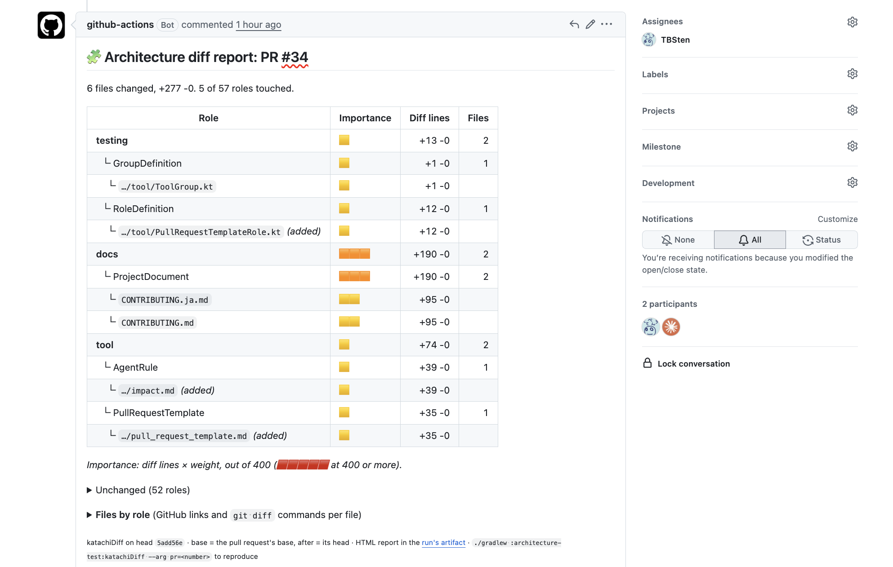
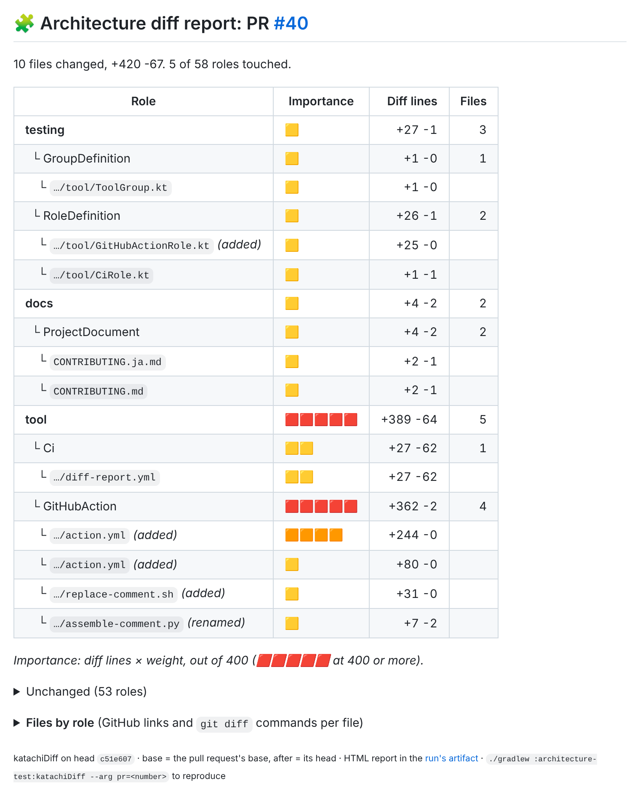
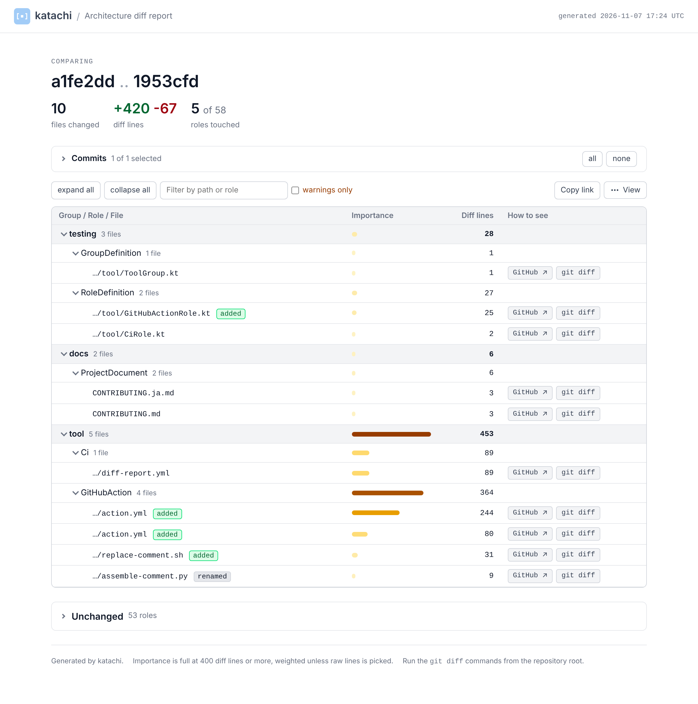
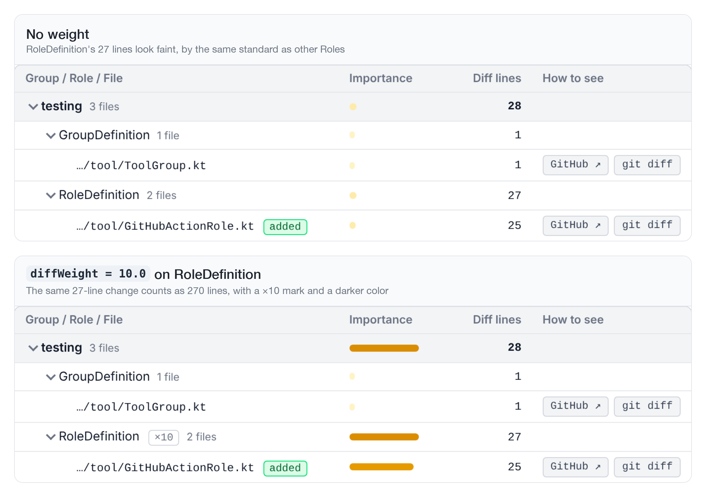

import { Aside, CardGrid, LinkCard, Tabs, TabItem } from '@astrojs/starlight/components';

## What you can do with the diff report

It is handy if a pull request shows a report of which Roles the pull request changed.



- katachi analyzes the diff using your architecture definition. So you can trust the range of the change as a range computed by a machine.
  - You do not need to carefully check an AI summary that may be inaccurate 👍
- A plain `git diff` only lists the files that have a diff. There are many of them, so it is hard to quickly see what kind of files changed. If you combine it with the information in the katachi architecture definition, you get a grouping one level more abstract. This helps you understand the diff.

In katachi, you can use `katachiDiff` to output a report that analyzes the diff.

## Analyze a diff with katachiDiff

You pass the Git diff information to the built-in `katachiDiff` and call it. It generates reports in HTML and Markdown.

```shell
# The diff between main and the working tree (includes uncommitted changes)
./gradlew :architecture-test:katachiDiff --arg before=origin/main

# The diff between the base and head of a pull request (resolved with the gh command)
./gradlew :architecture-test:katachiDiff --arg pr=123
```

The reports are written to `architecture-test/build/katachi/diff/`.

| File | Content |
|---|---|
| `diff-report.html` | A self-contained HTML file. It shows the Importance of each group / Role and the list of files. You can also filter by commit |
| `diff-report.md` | A summary table in Markdown. It is for pasting into a pull request comment |
| `diff-report.files-by-role.md` | The list of changed files for each Role |
| `diff-report.files-in-no-role.md` | The list of changed files that match no Role. These files also fail the architecture test |

You can improve the review experience by adding `katachiDiff` to CI, a review-assist Agent Skill, and so on.

## Example reports

<details>
  <summary>Example of diff-report.md</summary>

  
</details>

<details>
  <summary>Example of diff-report.html</summary>

  
</details>

## Weights

You can set a weight on a Role in the architecture definition.
The higher the weight, the darker the heatmap color in the Importance column, even with fewer changed lines. This makes changes to files of Roles that should not change often stand out more.

```kt title=ProjectArchitecture.kt {12,19} nocollapse
@file:OptIn(ExperimentalKatachiApi::class)

import me.tbsten.katachi.ExperimentalKatachiApi
import me.tbsten.katachi.dsl.architecture
import me.tbsten.katachi.dsl.gradle.*
import me.tbsten.katachi.dsl.kotlin.ktFile
import me.tbsten.katachi.diff.diffWeight

val projectArchitecture = architecture {
  "Domain".group {
    // If you write it on a group, it applies to all Roles under it
    diffWeight = 2.0

    "UseCase".role { layout { "domain" / "*UseCase".ktFile() } }
  }
  "Testing".group {
    "RoleDefinition".role {
      // If you write it on a Role, it takes priority over the group's value
      diffWeight = 10.0
      layout { "architecture-test" / testSourceSet / kotlin / "**" / "*Role".ktFile() }
    }
  }
}
```

Even for the same diff, the Importance column looks different with and without a weight, like this.



## Detailed settings of katachiDiff

katachiDiff has the following options. You can set all of them when you run the command or in the Gradle script.

<Tabs>
  <TabItem value="command" label="Options in the command">
    ```shell
    ./gradlew :architecture-test:katachiDiff \
      --arg before=origin/main \
      --arg weights=Domain=2,Testing.RoleDefinition=10 \
      --arg maxFiles=0 \
      --arg html=false \
      --arg markdownOutputFile=diff-report.md
    ```
  </TabItem>

  <TabItem value="gradle" label="Options in the Gradle script">
    ```kts nocollapse title="architecture-test/build.gradle.kts"
    katachi {
      processors {
        diff {
          before = "origin/main"
          weights = listOf("Domain=2", "Testing.RoleDefinition=10")
          maxFiles = 0
          markdown {
            outputFile = layout.projectDirectory.file("diff-report.md")
          }
          html {
            enable = false
          }
        }
      }
    }
    ```
  </TabItem>
</Tabs>

A value written in the Gradle script becomes the default for the project, and `--arg` on the command takes priority. For example, you can run with `before = "origin/main"` day to day, and compare a pull request with `--arg pr=123` in CI.

<table>
    <thead>
        <tr>
            <th>Option</th>
            <th>Type</th>
            <th style="min-width: 16rem;">Description</th>
            <th>Default</th>
            <th>Example</th>
        </tr>
    </thead>
    <tbody>
        <tr>
            <td><code>before</code></td>
            <td><code>String</code></td>
            <td>The ref where the comparison starts. It is ignored when <code>pr</code> is set</td>
            <td><code>HEAD</code></td>
            <td><code>origin/main</code><br /><code>v0.3.0</code> (compare with the previous release)<br /><code>HEAD~5</code></td>
        </tr>
        <tr>
            <td><code>after</code></td>
            <td><code>String</code></td>
            <td>The ref where the comparison ends. When empty, it is the working tree (includes uncommitted files)</td>
            <td>Empty</td>
            <td><code>HEAD</code> (compare only committed changes)<br /><code>feature/login</code><br /><code>abc1234</code></td>
        </tr>
        <tr>
            <td><code>pr</code></td>
            <td><code>String</code></td>
            <td>The number or URL of a pull request. It resolves the base and head with <code>gh pr view</code> and compares them with <code>base...head</code>, the same as GitHub. It takes priority over <code>before</code> / <code>after</code></td>
            <td>Empty</td>
            <td><code>123</code><br /><code>https://github.com/TBSten/katachi/pull/123</code></td>
        </tr>
        <tr>
            <td><code>weights</code></td>
            <td><code>List&lt;String&gt;</code></td>
            <td>A list of <code>&lt;qualified name of a group or Role&gt;=&lt;number&gt;</code>. It takes priority over <code>diffWeight</code> in the definition. On the command, separate them with commas</td>
            <td>Empty</td>
            <td><code>Domain=2</code><br /><code>Domain=2,Testing.RoleDefinition=10</code><br /><code>Sample=0.5</code> (make it less noticeable)</td>
        </tr>
        <tr>
            <td><code>maxFiles</code></td>
            <td><code>Int</code></td>
            <td>The maximum number of files in the file list. With 0 or less, it lists all of them. The group / Role rows are not cut. They are counted from all files</td>
            <td><code>100</code></td>
            <td><code>0</code> (list all)<br /><code>30</code><br /><code>500</code></td>
        </tr>
        <tr>
            <td><code>markdown</code></td>
            <td><code>Boolean</code></td>
            <td>Whether to write the Markdown report</td>
            <td><code>true</code></td>
            <td><code>false</code> (write only HTML)<br /><code>true</code></td>
        </tr>
        <tr>
            <td><code>markdownOutputFile</code></td>
            <td><code>String</code></td>
            <td>Where to write the Markdown report. The two list files are placed in the same directory</td>
            <td><code>build/katachi/diff/diff-report.md</code></td>
            <td><code>diff-report.md</code><br /><code>build/reports/katachi/diff.md</code><br /><code>.local/tmp/diff.md</code></td>
        </tr>
        <tr>
            <td><code>html</code></td>
            <td><code>Boolean</code></td>
            <td>Whether to write the HTML report</td>
            <td><code>true</code></td>
            <td><code>false</code> (write only Markdown)<br /><code>true</code></td>
        </tr>
        <tr>
            <td><code>htmlOutputFile</code></td>
            <td><code>String</code></td>
            <td>Where to write the HTML report</td>
            <td><code>build/katachi/diff/diff-report.html</code></td>
            <td><code>diff-report.html</code><br /><code>build/reports/katachi/diff.html</code><br /><code>.local/tmp/diff.html</code></td>
        </tr>
        <tr>
            <td><code>fullImportanceLines</code></td>
            <td><code>Int</code></td>
            <td>The number of weighted diff lines at which Importance reaches its maximum. You can set it only with <code>--arg</code> on the command</td>
            <td><code>400</code></td>
            <td><code>200</code> (darker even with a small diff)<br /><code>1000</code> (a repository with many large changes)<br /><code>400</code> (same as the default)</td>
        </tr>
    </tbody>
</table>

## Add it to CI

On GitHub Actions, use the two actions that katachi provides. `diff-report` runs `katachiDiff` and builds the comment body, and `diff-report-comment` posts it to the pull request. From the second time on for the same pull request, it deletes the previous comment and posts again, so there is always only one comment.

```yaml nocollapse title=".github/workflows/diff-report.yml"
name: Diff report

on:
  pull_request:
    types: [ opened, synchronize, reopened ]

jobs:
  report:
    runs-on: ubuntu-latest
    permissions:
      contents: read
    steps:
      - uses: actions/checkout@v7
        with:
          # pr= compares the base and the head, so check out the head with its full history
          ref: ${{ github.event.pull_request.head.sha }}
          fetch-depth: 0
      - uses: actions/setup-java@v6
        with:
          distribution: temurin
          java-version: '17'
      - uses: gradle/actions/setup-gradle@v6
      - uses: TBSten/katachi/diff-report@v0.4.0
        with:
          task: ':architecture-test:katachiDiff'

  comment:
    needs: report
    runs-on: ubuntu-latest
    permissions:
      pull-requests: write
    steps:
      - uses: TBSten/katachi/diff-report-comment@v0.4.0
```

| Input <br/> (`diff-report`) | Description | Default |
|---|---|---|
| `task` | The Gradle task to run. With `katachiDiff`, it runs in all modules that have the plugin applied | `katachiDiff` |
| `arguments` | Extra arguments to pass to Gradle. One per line (example: `--arg weights=Domain=2`). The action adds `--arg pr=` | Empty |
| `working-directory` | The directory that has the Gradle build | `.` |
| `comment` | With `true`, this job also posts the comment | `false` |
| `report-artifact-name` | The name of the artifact that uploads the HTML report and the whole Markdown. Empty to skip the upload | `katachi-diff-report` |

For a pull request from a fork, the token cannot write comments, so `diff-report-comment` ends without doing anything. You can read the report in the summary and the artifact of the `report` job.

## Agent skill

If your project has a review Agent skill, make it run `katachiDiff` and include the result in the review output.

An Agent can see which parts of the architecture a change touches more quickly and more accurately by reading a report grouped by Role than by reading `git diff` itself.

```md title=".agents/skills/review/SKILL.md"
---
name: review
description: Review a pull request from the architecture point of view
---

1. Run `./gradlew :architecture-test:katachiDiff --arg before=origin/main`
2. Read `architecture-test/build/katachi/diff/diff-report.md` and check the diff in order, starting from the Roles with high Importance
3. If `diff-report.files-in-no-role.md` has files, suggest either adding them to the definition or fixing where they are placed
4. At the top of the review result, quote from the report the list of Roles the change touches
```

## Summary

- `katachiDiff` sorts a Git diff into the groups / Roles of the architecture definition and makes HTML and Markdown reports
- Use `before` / `after` to compare a local diff, and `pr` to compare the diff of a pull request
- Use `diffWeight` in the definition to make changes to Roles that need attention stand out. For a single run, you can override it with `weights`
- If CI posts the report as a comment on the pull request, it becomes the entry point of the review

## Next steps

<CardGrid>
  <LinkCard
    title="Layout"
    href="/katachi/guides/layout/"
    description="How to write layout { }, which is the basis for sorting files into Roles."
  />
  <LinkCard
    title="ArchitectureProcessor and its customization"
    href="/katachi/guides/processor/"
    description="How to make your own processor with the same mechanism as katachiDiff."
  />
  <LinkCard
    title="GitHub"
    href="/katachi/recipes/github/"
    description="A recipe for declaring the workflows under .github/ in the definition."
  />
</CardGrid>
