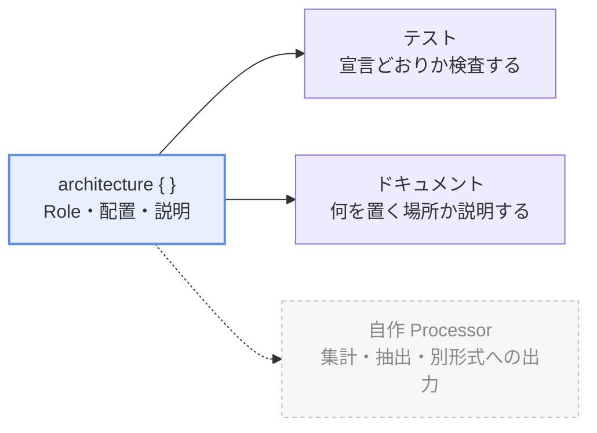

{/*
  このページの目的: motivation を読んだユーザが、katachi の設計思想をより深く理解できるようになること。
*/}

import {CardGrid, FileTree, LinkCard} from '@astrojs/starlight/components';

このページは **katachi がなぜこの形をしているのか** に答えます。
導入手順や書き方は [初めてのアーキテクチャ定義](/katachi/ja/get-started/first-architecture/) を参照してください。

## なぜ「宣言されていないファイルは違反」なのですか

アーキテクチャが壊れるとき、壊れ方はたいてい **「ルールに違反するものが書かれた」ではなく
「誰も想定していない場所に何かが増えた」** です。

禁止リスト方式（「`domain` から `android.*` を import してはいけない」）は、
**思いついた禁止事項しか守れません。** 思いつかなかった壊れ方は、検査に引っかからず、そのまま許容されてしまいます。
そして一番多いのは、思いつかなかった壊れ方です。

katachi は逆に、**現れてよいものを全部書かせます。** 書いていないものは違反です。
これなら「想定していなかった」が起きません。想定していないもの自体が違反だからです。

違うのは**列挙し損ねたものを許容するか、違反にするか**、その1点だけです。

<details>
    <summary>セキュリティ分野にも同じ考え方があります</summary>

    想定外のものをまず疑う考え方は、セキュリティの分野にもあります。

    これは **fail-safe defaults**（デフォルトの振る舞いを安全なほう、つまり許可しないほうにしておく）と呼ばれる設計原則の1つです。

    **禁止を列挙する方式では、列挙し損ねたものを検査が見逃してしまいます。**
    シグネチャ方式のマルウェア対策が未知の検体を止められないのと同じで、
    **抜けたものがあると、本来望ましくない状態を気づかないうちに許容してしまいます。**
    許可を列挙する方式なら、抜けたものは違反になるので、その場で気づけます。
    抜けたときにどちらになってほしいか、という選択です。

    **代償も同じ**です。許可リストは列挙が大変で、運用が重い。
    それでも守る価値のある境界では採用されます。katachi の「最初が重い」も同じ話です。

    もっとも katachi はセキュリティのための道具ではありません。
    借りているのは判断の形だけで、守っているのはアーキテクチャです。

</details>

この設計の代償は **最初が重い** ことです。
プロジェクトにあるファイルを全部説明しきるまでテストは Green になりません。
それでも、**説明しきれないファイルがあるという事実のほうが情報** だと
考えています。それは本当に要るファイルですか。

## 既存のプロジェクトに入れたら、違反だらけになりませんか

なります。それが一般的な出発点です。

初回の実行で出てくる違反の一覧は、そのまま
**「このプロジェクトには、誰も説明できていないファイルがこれだけある」** という報告です。
katachi が壊したのではなく、もともとそうだったものが見えただけです。

出てきたパスを1つずつ、定義に足すか・移すか・消すかで片付けていきます。
チームメンバがいるなら、ぜひチームメンバと一緒に話し合いながら決めていきましょう。
これはそのまま、**チームがアーキテクチャについて合意し直す作業**でもあります。

すぐには片付けきれない場合は、実験的な機能の baseline（`architecture { baseline() }`）で
今ある違反をとりあえず許容し、新しい違反だけをエラーにすることもできます。
許容は一時的なもので、直した違反は baseline のファイルから消していきます。書き方は [baseline](/katachi/ja/guides/baseline/) を参照してください。

## Konsist や ArchUnit があるのに、なぜ別のものが要るのですか

[katachi](/katachi/ja/get-started/motivation/) と [Konsist](https://docs.konsist.lemonappdev.com/)・[ArchUnit](https://www.archunit.org/) では、検証する範囲が違います。

| ツール | 検証する範囲 |
|---|---|
| Konsist・ArchUnit | 絞り込んだ対象だけ。絞りに入らないものは見ない |
| katachi | プロジェクト全体。宣言と突き合わせる |

Konsist や ArchUnit は **「対象を絞ってから、その中身を検証する」** ツールです。

```kt title="UseCaseKonsistTest.kt" {1-4}
// ここで絞る
Konsist.scopeFromProject()
  .classes()
  .withNameEndingWith("UseCase")   

  // 絞ったもののみ検証
  .assertTrue { /* ... */ }
```

この書き方では、絞った範囲に入らないものは検証されません。

<FileTree>
- src/main/kotlin/com/example/
  - useCase/
    - GetUserUseCase.kt 絞りに入る
  - UserHelper.kt 絞りに入らない
  - misc/
    - memo.md 絞りに入らない
</FileTree>

次に katachi です。向きが逆で、**プロジェクト全体を走査して、宣言と突き合わせます。**
同じ3つのファイルについて、それぞれのツールが何を報告するかを比べます。

| ファイル | Konsist・ArchUnit | katachi |
|---|---|---|
| `GetUserUseCase.kt` | 絞りに入るので、中身を検証する | 宣言された場所にあれば問題なし。別の場所にあれば違反 |
| `UserHelper.kt` | 絞りに入らないので、何も報告しない | どの Role にも当てはまらないので、違反として報告する |
| `misc/memo.md` | 絞りに入らないので、何も報告しない | どの Role にも当てはまらないので、違反として報告する |

「あるべきでないものがある」を見つけるには、**全体を見る側の道具**が要ります。

## katachi は Konsist の上位互換ですか

いいえ、置き換えるものではなく、併用するのがおすすめの使い方です。katachi と Konsist では見る範囲が違います。

| ツール | 何を見るか | 例 |
|---|---|---|
| katachi | ファイルが**どこにあるか** | `UseCase` は `useCase/` に置く |
| katachi（`ktFileContent { }`） | ファイルに置いてよい**宣言の形**。package・import・宣言の種類・名前・修飾子 | `UseCase` のファイルには `invoke` を持つ class を1つだけ置く |
| Konsist | 宣言の**中身や関係**。関数の本体・参照先・ファイルをまたぐ関係 | `UseCase` にはそれぞれテストクラスがある |

`ktFileContent { }` が見るのは、ファイルに書かれた宣言の並びです。
関数の本体で何を呼ぶか、別のパッケージのクラスをどう使うかは見ません。
そこは Konsist の仕事です。

たとえば「`UseCase` にはそれぞれテストクラスがある」は、複数のファイルにまたがる関係なので Konsist で書きます。

```kotlin
Konsist.scopeFromProject()
  .classes()
  .withNameEndingWith("UseCase")
  .assertTrue { it.hasTestClasses() }
```

`ktFileContent { }` の範囲の違反は、配置の違反と合わせて1つのレポートにまとまります。
テストで `assert(FileConstraintCheck())` を呼べば、「ファイルの場所」と「ファイルに置いてよい宣言」の違反を一度に確認できます。
宣言の中身や関係の検証は、Konsist のテストで別に行います。

「ファイルの中身を検証する」という立ち位置は、Konsist だけのものではありません。
検証したいルールによっては [detekt](https://detekt.dev/) のカスタムルールが Konsist の代わりになるかもしれません。

<CardGrid>
    <LinkCard
        title="他ツールとの比較"
        description="detekt など、中身を検証する他の選択肢との関係。"
        href="/katachi/ja/get-started/comparison-with-other-tools/"
    />
</CardGrid>

## テストが1本しかないのはなぜですか

**1回走らせれば全部わかる**ようにしたいからです。

ルールごとにテストを分けると、1つ失敗した時点でそのテストは止まります。
直して再実行して、次の違反を知って、また直す。**違反の数だけ往復**することになります。

katachi は `assert()` を1回呼ぶだけで、リポジトリ全体の違反が**1つの失敗メッセージ**に集まります。
10箇所おかしければ10箇所が一度に出ます。読むのは1回です。

```text title="エラーメッセージの例" {1}
Katachi check failed: 3 violations (Unexpected: 2, Missing: 1)

[UnexpectedFile] file:///path/to/project/src/main/kotlin/com/example/GetUserUseCase.kt
  No role is defined for this file.

  Nearby locations:
    UseCase file:///path/to/project/src/main/kotlin/com/example/useCase/ (*UseCase.kt)

  How to fix:
    - Move it to one of the locations above, with a name matching the pattern in parentheses
    ...

[UnexpectedDirectory] file:///path/to/project/src/main/kotlin/com/example/misc
  ...

[MissingFile] file:///path/to/project/src/main/kotlin/com/example/useCase/DeleteUserUseCase.kt
  ...
```

## テストが成功していれば、ドキュメント生成は要らないのでは

ドキュメント生成はオプション機能ですが、**使うことを推奨します。**
テストは人間向けの説明ではないからです。

`assert()` が守ってくれるのは「定義どおりになっていること」だけです。
新規参画者や AI Agent が知りたいのは「**なぜ**この構造なのか」ですが、それはテストの出力には出てきません。

かといってドキュメントを別に書けば、**実装を変えたときにドキュメントの更新が漏れて、内容が実装と食い違っていきます。**
食い違ったドキュメントは無いよりたちが悪いのです。食い違いに誰も気づかないまま、それを信じて作業してしまうからです。

そこで katachi は、**同じ定義から両方を出します**。Role に書いた `summary` や
`description` が、検査の対象であると同時にドキュメントの本文になります。



図 1. 1つの定義からテストとドキュメントを出す流れ

アーキテクチャ定義が Single Source of Truth になるので、**片方だけが古くなることを防げます。**

テストとドキュメントは katachi が用意しているものですが、**この2つに限りません。**
同じ定義から自分で何かを取り出すこともできます。
やり方は [ArchitectureProcessor とそのカスタマイズ](/katachi/ja/guides/processor/) を参照してみてください。

## Role の名前や粒度は、どう決めればいいのですか

**チームが今その言葉を使っているかどうか**を基準にしてください。

katachi の Role は、新しい概念を導入するためのものではありません。
すでに口頭やレビューで使われている言葉（「これは UseCase だよね」「Repository に置いて」）を、
そのまま宣言として書き出すものです。

そのため、**定義はチームの合意物**であり、重要なレビューの対象です。
AI Agent に初期の定義を作らせても、それは既存コードからの推測にすぎません。
**最終的にチームが読んで合意する**ことを前提にしています。
