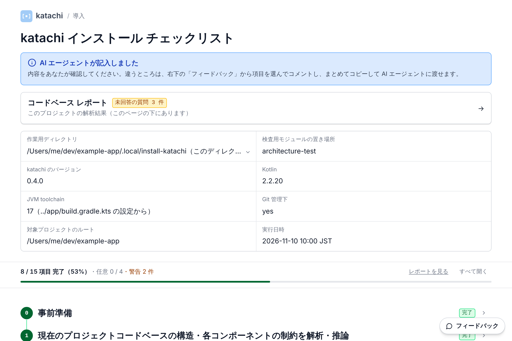

{/*
  このページの目的: katachi のモチベーションを理解したユーザが、自分のプロジェクトに katachi を導入することができること。導入の中には Gradle モジュールの設定・周辺の設定を含む。
*/}

import { Aside, Tabs, TabItem, Steps, Badge, CardGrid, LinkCard } from '@astrojs/starlight/components';

このページでは AI Agent を用いて katachi を Gradle プロジェクトに入れ、最初の `architecture { }` 定義を書いて、テストが成功するところまでを説明します。

katachi が必要かどうか迷う場合は、先に [モチベーション](/katachi/ja/get-started/motivation/) を読むことをおすすめします。

## AI Agent と katachi をプロジェクトに導入する

katachi を導入してテストを成功させるには、プロジェクト内に存在するすべてのファイルの種類を洗い出す必要があります。
katachi を導入するプロジェクトが大きければ大きいほど、この洗い出し作業は大変でしょう。

そこで AI Agent にこの作業を任せてみましょう。katachi には AI Agent driven で katahi のセットアップを支援する CLI, Agent Skill が用意されています。

手動でインストールが必要な場合は [手動インストール](/katachi/ja/get-started/manual-install/) を参照してください。

### 1. katachi CLI, Agent Skill をインストールする

CLI は Homebrew で以下のようにインストールできます。

```shell
brew install tbsten/tap/katachi
```

Agent Skill は gh skills か npx skills でインストールできます。

<Tabs>
  <TabItem label="gh skills">
    ```shell
    gh skill install TBSten/katachi katachi
    ```
  </TabItem>

  <TabItem label="npx skills">
    ```shell
    npx skills add TBSten/katachi --skill katachi
    ```
  </TabItem>
</Tabs>

---

<details>
<summary>追加オプション</summary>

- **Git**

  あらかじめプロジェクトを Git で管理しておくことをお勧めします。

- **追加のドキュメンテーション**

  アーキテクチャに関するドキュメントがコードベースの外にある場合（例: Notion で管理しているなど）、そのリンクを用意して AI Agent がアクセスできるようにしておいてください。

- **モジュールなどの構成情報**

  AI Agent は、デフォルトでは `architecture-test` モジュールを作り、そこにアーキテクチャ定義を書こうとします。別のモジュールに作成したい場合は `テストは <module> に作成してください` のようなプロンプトを追加してください。

- **セッション**

  context 管理の一環として、katachi 導入専用のセッションを新規に開始することをおすすめします。Claude Code, Codex CLI の場合は `/clear` コマンドでセッションをクリアしてからプロンプトを入力します。

</details>

### 2. AI Agent にプロジェクトアーキテクチャの収集を指示する

```md
このプロジェクトに katachi を導入してください。
```

プロンプトを受け取ると Agent は katachi Agent Skill に従ってプロジェクトの情報を収集します。

Agent が収集した情報は インストールチェックリストと呼ばれる HTML ファイル に出力されるため、その内容がプロジェクトで想定されているアーキテクチャと一致しているかレビューしてください。



- インストールチェックリスト内には AI Agent が判断に迷った箇所を **質問形式で掲載** する場合があります。フォームに従って回答を入力してください。
- 右下のフロートボタンから **フィードバックモード** を開始して、気になる箇所・アーキテクチャの指摘をピンポイントで記入できます。
- 1つ以上回答を入力するとフローティングメニューが表示されます。フローティングメニュー内のコピーボタンを押下して AI Agent 二回等を返却しましょう。

<details>
  <summary>インストールチェックリストの例</summary>

  <iframe
    src="/katachi/install/ja/check-list-sample.html"
    title="インストールチェックリストの例"
    loading="lazy"
    style="width: 100%; height: 40rem; border: 1px solid var(--sl-color-gray-5); border-radius: 0.5rem;"
  ></iframe>

  [インストールチェックリストの例を新しいタブで開く](/katachi/install/ja/check-list-sample.html)

</details>

### 3. アーキテクチャ定義をレビューする

AI Agent が生成したらアーキテクチャ定義をレビューして、最終的にプロジェクトに取り込んで良いものかよく吟味してください。

注目すべき点:

- [ ] **`architecture-test/src/test/kotlin/<パッケージ>/ProjectArchitecture.kt`** がエントリーポイントです。ここを起点に、そこから呼び出されている各 Role がプロジェクトで正とされる宣言になっているかを確認してください。
- [ ] チームで開発している場合は、**チームメンバー（特にチームのリード）にも重点的にレビュー** してもらいましょう。


## CI に組み込む (オプション)

品質を維持するには、katachi のアーキテクチャテストを CI に組み込み、定期的に実行させることが大切です。

品質を維持するには、katachi のアーキテクチャテストを CI に組み込み、定期的に実行させることが大切です。

<Tabs>
    <TabItem label="GitHub Actions">
        以下のようなワークフローファイルを追加してください。

        ```yaml nocollapse title=".github/workflows/architecture.yml"
        name: Architecture

        on:
          push:
            branches: [main]
          pull_request:

        permissions:
          contents: read

        jobs:
          architecture:
            runs-on: ubuntu-latest
            steps:
              - uses: actions/checkout@v7

              - uses: actions/setup-java@v6
                with:
                  distribution: temurin
                  java-version: '17'

              - uses: gradle/actions/setup-gradle@v6

              - run: ./gradlew :architecture-test:test
        ```

    </TabItem>

    <TabItem label="その他の CI システム">
        次のようなワークフローを、それぞれの CI システムの仕様に合わせて記述します。

        1. Java をセットアップする。
        2. `./gradlew :architecture-test:test` を実行する。
        3. 2 の結果をレポートする。
    </TabItem>
</Tabs>

## 次のステップ

<CardGrid>
  <LinkCard
    title="基本的な API"
    href="/katachi/ja/guides/basic-api/"
    description="katachi の定義を書くときに最初に覚える API を学びましょう。"
  />
  <LinkCard
    title="Role"
    href="/katachi/ja/guides/role/"
    description="定義の基本単位である Role の書き方と、分け方の考え方を学びましょう。"
  />
  <LinkCard
    title="Layout"
    href="/katachi/ja/guides/layout/"
    description="ディレクトリ構成を厳守させる Layout の書き方を学びましょう。"
  />
  <LinkCard
    title="sample/jvm"
    href="https://github.com/TBSten/katachi/tree/main/sample/jvm"
    description="Ktor の最小サーバに定義を入れた、動く実物です。"
  />
</CardGrid>
