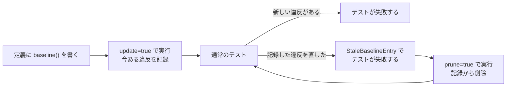

import { CardGrid, LinkCard } from '@astrojs/starlight/components';

{/*
  このページの目的: 既存プロジェクトに katachi を導入する際に役立つ Baseline 機能について深く網羅的に理解する。
*/}

既存のプロジェクトに katachi を入れると、最初の実行で **宣言していないファイルやディレクトリが違反として出ます。** 出てきたパスを定義に足すか・移すか・消すかで片付けていくのが基本ですが、数が多いとすぐには片付けきれないでしょう。

baseline は、既存の違反を一時的に抑制して、新しい違反をテストでエラーにする機能です。

次の図は、baseline を使った一連の流れです。定義に `baseline()` を書き、`update` で今ある違反を記録します。その後、違反を直したら `prune` で記録から削除します。



図 1. baseline の流れ。記録した違反はテストを失敗させず、新しい違反と、直したのに残っている記録だけがテストを失敗させる

## 設定する

### 1. 定義に `baseline()` を書く

`ProjectArchitecture.kt` の `architecture { }` に `baseline()` を足します。

```kt title="ProjectArchitecture.kt（抜粋）" {3}
val projectArchitecture: Architecture = architecture {
  // ...
  baseline()

  // ...
}
```

baseline を設定すると、デフォルトではプロジェクトルートの `katachi-baseline.json` が Baseline ファイルとして使われます。

### 2. Baseline ファイル自身を `layout { }` で宣言する

Baseline ファイルもプロジェクトのファイルの1つなので、Role として宣言しないと `projectArchitecture.assert()` でエラーになってしまいます。

慣例に従って "BaselineFile" という名前の Role を用意して architecture 定義内に追加してください。

```kt
val projectArchitecture = architecture {
  // ...
  "Tool".group {
    "Katachi".group {
      baselineFile()
    }
  }

  // ...
}

fun DeclarationContainerScope.baselineFile() = "BaselineFile".role {
  title = "katachi Baseline ファイル"
  summary = "既存の違反を一時的に抑制するためのファイル"
  description = "参照: https://tbsten.github.io/katachi/ja/guides/baseline/"
  layout {
    "katachi-baseline.json".file()
  }
}
```

### 3. Baseline ファイルを作成する

`-Dkatachi.baseline.update=true` を付けてアーキテクチャテストを実行すると、全ての違反はエラーにならず、許容されて Baseline ファイルに書き込まれます。

```shell
./gradlew :architecture-test:test -Dkatachi.baseline.update=true
```

作成・更新されたファイルは、コミットすることをおすすめします。

[`ktFileContent { }`](/katachi/ja/guides/kt-file-content/) の違反は、宣言ごとに記録されます。たとえば `GetUserUseCaseImpl`・`HomeViewModel.isLoading`・`import android.content.Context`・`package com.example.home` のような単位です。行番号は記録しないので、同じファイルに行を足して違反の行がずれても、許容した違反は許容されたままです。（AI の下書き）

baseline で許容した違反は、テストを失敗させないだけでなく、SARIF のレポート（`report { sarif = true }`）にも書かれません。

## 許容していた違反を直したあと

許容されていた違反を直すと、Baseline ファイルにはもう存在しない違反の記録が残ります。放っておくと、あとで同じパスに置かれた別のファイルが気づかないうちに通ってしまいます。そのため katachi はこの残りを `[StaleBaselineEntry]` として報告し、**テストを失敗させます。**

Baseline ファイルから修正した違反を削除するには、`-Dkatachi.baseline.prune=true` を付けて、もう一度アーキテクチャテストを実行します。

```shell
./gradlew :architecture-test:test -Dkatachi.baseline.prune=true
```

prune は、記録の件数を**減らすだけ**です。新しい違反を Baseline ファイルに足すことはありません（足すのは `-Dkatachi.baseline.update=true` の役目です）。違反が減った Baseline ファイルは再度コミットしてください。

## まとめ

ここまでの設定を1つにした完成形です。

```kt
// 記録する: ./gradlew :architecture-test:test -Dkatachi.baseline.update=true
// 削除する: ./gradlew :architecture-test:test -Dkatachi.baseline.prune=true
val projectArchitecture = architecture {
  baseline()

  "BaselineFile".role {
    summary = "既存の違反を一時的に抑制するためのファイル"
    layout {
      "katachi-baseline.json".file()
    }
  }
}
```

## 次のステップ

<CardGrid>
  <LinkCard
    title="初めてのアーキテクチャ定義"
    href="/katachi/ja/get-started/first-architecture/"
    description="baseline で許容する前の、最初の定義の書き方です。"
  />
  <LinkCard
    title="Role"
    href="/katachi/ja/guides/role/"
    description="Baseline ファイルの Role のように、Role の説明・置き場所・制約をまとめて書く方法を学びましょう。"
  />
  <LinkCard
    title="Layout"
    href="/katachi/ja/guides/layout/"
    description="宣言していない場所のファイルを違反にする、置き場所の書き方を学びましょう。"
  />
  <LinkCard
    title="sample/jvm の katachi-baseline.json"
    href="https://github.com/TBSten/katachi/blob/main/sample/jvm/katachi-baseline.json"
    description="記録された違反の実物です。意図的に残した違反の理由は、ソースのコメントに書いてあります。"
  />
</CardGrid>
