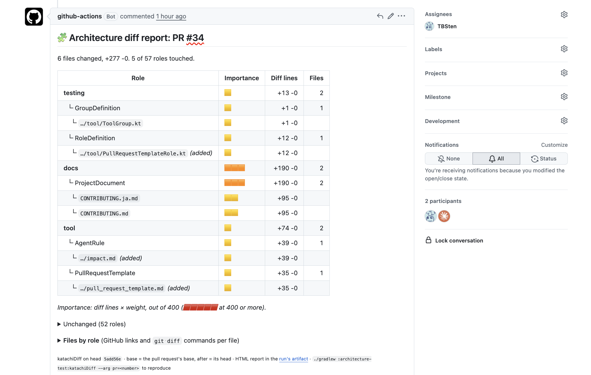
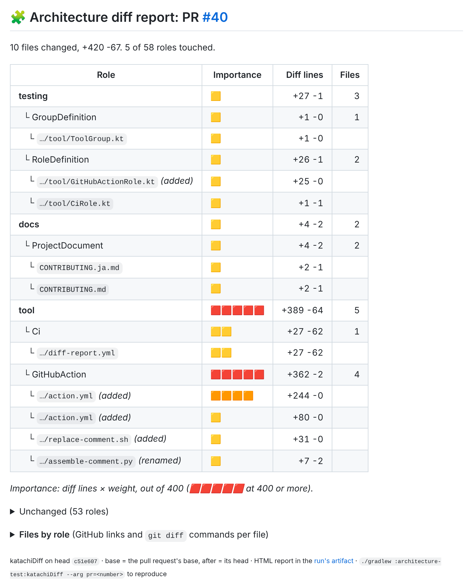
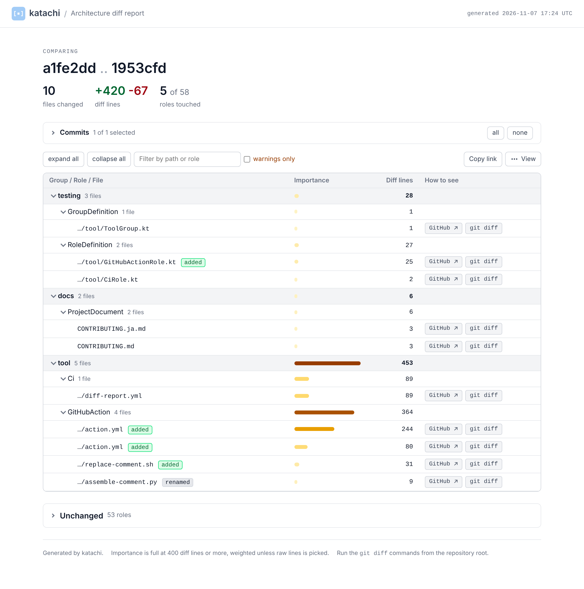
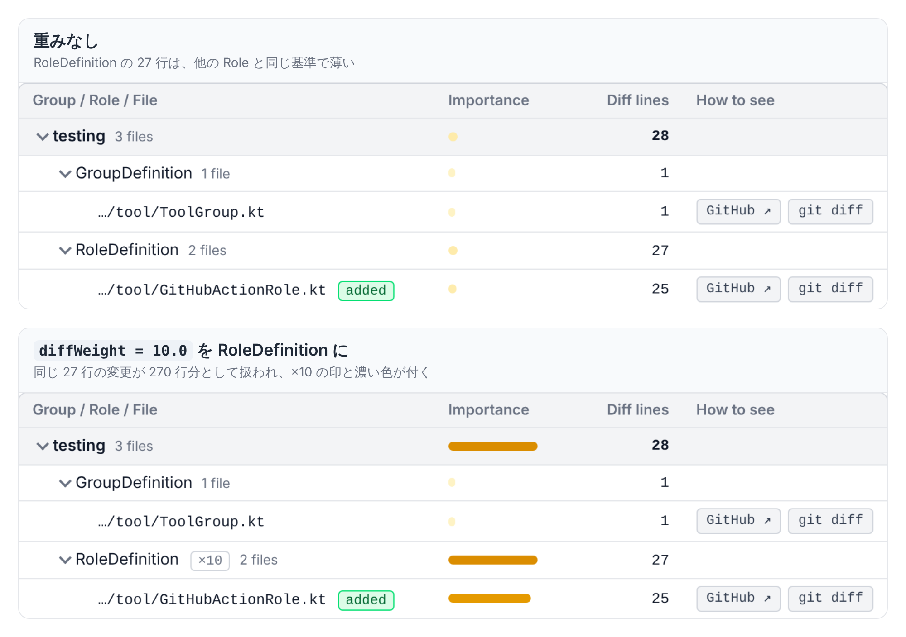

import { Aside, CardGrid, LinkCard, Tabs, TabItem } from '@astrojs/starlight/components';

## Diff report を導入して できること

Pull request にその Pull request でどの Role が変わったのか report が表示されると便利でしょう。



- katachi のアーキテクチャ定義から差分を解析することで、変更範囲を機械的に算出された範囲として信頼することができます。
  - AI がサマライズした不正確な可能性のある概要を注意深く確認する必要はありません👍
- 単純な `git diff` では単に差分があるファイルのみが列挙されます。これは量が多くどんなファイルの変更があるのかを素早くキャッチアップするのには向きません。katachi のアーキテクチャ定義の情報を組み合わせることで一段抽象化したグルーピングが可能になり、変更差分の把握の助けになるでしょう。

katachi では `katachiDiff` を使って 差分を分析するレポートを出力することができます。

## katachiDiff で差分を解析する

組み込みの `katachiDiff` に Git の差分情報を渡して呼び出すことで、html, markdown 形式のレポートを生成することができます。

```shell
# main と作業ツリーの差分（コミットしていない変更も含む）
./gradlew :architecture-test:katachiDiff --arg before=origin/main

# Pull request の base と head の差分（gh コマンドで解決する）
./gradlew :architecture-test:katachiDiff --arg pr=123
```

レポートは `architecture-test/build/katachi/diff/` に出力されます。

| ファイル | 内容 |
|---|---|
| `diff-report.html` | 1 ファイルで完結する HTML。group / Role ごとの Importance、ファイルの一覧、コミットでの絞り込みができます |
| `diff-report.md` | Markdown の要約表。Pull request のコメントに貼る用です |
| `diff-report.files-by-role.md` | Role ごとの変更ファイルの一覧 |
| `diff-report.files-in-no-role.md` | どの Role にも当てはまらない変更ファイルの一覧。アーキテクチャテストでも違反になるファイルです |

これらのコマンドを CI, レビュー補助 Agent Skill などに組み込むことで、レビュー体験を向上させることができます。

## レポートの例

<details>
  <summary>diff-report.md の例</summary>

  
</details>

<details>
  <summary>diff-report.html の例</summary>

  
</details>

## 重み

アーキテクチャ定義の Role に重みを設定することが可能です。
重みが高いほど、Importance 列に表示されるヒートマップの色を少ない差分行数でも濃くすることができるため、頻繁に変更されるべきではない Role のファイル変更をより目立たせることができます。

```kt title=ProjectArchitecture.kt {10,17} nocollapse
@file:OptIn(ExperimentalKatachiApi::class)

import me.tbsten.katachi.ExperimentalKatachiApi
import me.tbsten.katachi.dsl.architecture
import me.tbsten.katachi.diff.diffWeight

val projectArchitecture = architecture {
  "domain".group {
    // group に書くと、配下の Role 全部に適用されます
    diffWeight = 2.0

    "UseCase".role { layout { "domain" / "*UseCase".ktFile() } }
  }
  "testing".group {
    "RoleDefinition".role {
      // Role に書くと、group の値より優先されます
      diffWeight = 10.0
      layout { "architecture-test" / testSourceSet / kotlin / "**" / "*Role".ktFile() }
    }
  }
}
```

同じ差分でも、重みの有無で Importance 列の見え方がこのように変わります。



## katachiDiff の詳細設定

katachiDiff には以下のようなオプションがあります。いずれも コマンド 実行時, Gradle script で設定が可能です。

<Tabs>
  <TabItem value="command" label="コマンドでのオプション指定">
    ```shell
    ./gradlew :architecture-test:katachiDiff \
      --arg before=origin/main \
      --arg weights=domain=2,testing.RoleDefinition=10 \
      --arg maxFiles=0 \
      --arg html=false \
      --arg markdownOutputFile=diff-report.md
    ```
  </TabItem>

  <TabItem value="gradle" label="Gradle script でのオプション指定">
    ```kts nocollapse title="architecture-test/build.gradle.kts"
    katachi {
      processors {
        diff {
          before = "origin/main"
          weights = listOf("domain=2", "testing.RoleDefinition=10")
          maxFiles = 0
          markdown {
            outputFile = layout.projectDirectory.file("diff-report.md")
          }
          html {
            enable = false
          }
        }
      }
    }
    ```
  </TabItem>
</Tabs>

Gradle script に書いた値はプロジェクトのデフォルト値になり、コマンドの `--arg` が優先されます。普段は `before = "origin/main"` で動かし、CI では `--arg pr=123` で Pull request を比べる、という使い方ができます。

<table>
    <thead>
        <tr>
            <th>オプション</th>
            <th>型</th>
            <th style="min-width: 16rem;">説明</th>
            <th>デフォルト</th>
            <th>例</th>
        </tr>
    </thead>
    <tbody>
        <tr>
            <td><code>before</code></td>
            <td><code>String</code></td>
            <td>比較の始点となる ref。<code>pr</code> があるときは無視されます</td>
            <td><code>HEAD</code></td>
            <td><code>origin/main</code><br /><code>v0.3.0</code>（前のリリースと比べる）<br /><code>HEAD~5</code></td>
        </tr>
        <tr>
            <td><code>after</code></td>
            <td><code>String</code></td>
            <td>比較の終点となる ref。空のときは作業ツリー（コミットしていないファイルも含む）</td>
            <td>空</td>
            <td><code>HEAD</code>（コミット済みだけを比べる）<br /><code>feature/login</code><br /><code>abc1234</code></td>
        </tr>
        <tr>
            <td><code>pr</code></td>
            <td><code>String</code></td>
            <td>Pull request の番号か URL。<code>gh pr view</code> で base と head を解決し、GitHub と同じ <code>base...head</code> で比べます。<code>before</code> / <code>after</code> より優先されます</td>
            <td>空</td>
            <td><code>123</code><br /><code>https://github.com/TBSten/katachi/pull/123</code></td>
        </tr>
        <tr>
            <td><code>weights</code></td>
            <td><code>List&lt;String&gt;</code></td>
            <td><code>&lt;group または Role の修飾名&gt;=&lt;数値&gt;</code> の一覧。定義の <code>diffWeight</code> より優先されます。コマンドではカンマ区切り</td>
            <td>空</td>
            <td><code>domain=2</code><br /><code>domain=2,testing.RoleDefinition=10</code><br /><code>sample=0.5</code>（目立たせない）</td>
        </tr>
        <tr>
            <td><code>maxFiles</code></td>
            <td><code>Int</code></td>
            <td>ファイルの一覧に載せる最大数。0 以下で全部載せます。group / Role の行は切らずに全ファイルから数えます</td>
            <td><code>100</code></td>
            <td><code>0</code>（全部載せる）<br /><code>30</code><br /><code>500</code></td>
        </tr>
        <tr>
            <td><code>markdown</code></td>
            <td><code>Boolean</code></td>
            <td>Markdown レポートを書くか</td>
            <td><code>true</code></td>
            <td><code>false</code>（HTML だけ書く）<br /><code>true</code></td>
        </tr>
        <tr>
            <td><code>markdownOutputFile</code></td>
            <td><code>String</code></td>
            <td>Markdown レポートの出力先。一覧の 2 ファイルは同じディレクトリに並びます</td>
            <td><code>build/katachi/diff/diff-report.md</code></td>
            <td><code>diff-report.md</code><br /><code>build/reports/katachi/diff.md</code><br /><code>.local/tmp/diff.md</code></td>
        </tr>
        <tr>
            <td><code>html</code></td>
            <td><code>Boolean</code></td>
            <td>HTML レポートを書くか</td>
            <td><code>true</code></td>
            <td><code>false</code>（Markdown だけ書く）<br /><code>true</code></td>
        </tr>
        <tr>
            <td><code>htmlOutputFile</code></td>
            <td><code>String</code></td>
            <td>HTML レポートの出力先</td>
            <td><code>build/katachi/diff/diff-report.html</code></td>
            <td><code>diff-report.html</code><br /><code>build/reports/katachi/diff.html</code><br /><code>.local/tmp/diff.html</code></td>
        </tr>
        <tr>
            <td><code>fullImportanceLines</code></td>
            <td><code>Int</code></td>
            <td>Importance が最大になる、重み付き差分行数。コマンドの <code>--arg</code> でのみ指定できます</td>
            <td><code>400</code></td>
            <td><code>200</code>（少ない差分でも濃くする）<br /><code>1000</code>（大きな変更が多いリポジトリ）<br /><code>400</code>（デフォルトと同じ）</td>
        </tr>
    </tbody>
</table>

## CI に組み込む

GitHub Actions には、katachi が配っている 2 つの action を使います。`diff-report` が `katachiDiff` を実行してコメントの本文を作り、`diff-report-comment` がそれを Pull request に貼ります。同じ Pull request への 2 回目以降は、前のコメントを消してから貼り直すので、コメントは常に 1 つです。

```yaml nocollapse title=".github/workflows/diff-report.yml"
name: Diff report

on:
  pull_request:
    types: [ opened, synchronize, reopened ]

jobs:
  report:
    runs-on: ubuntu-latest
    permissions:
      contents: read
    steps:
      - uses: actions/checkout@v7
        with:
          # pr= は base と head を比べるので、head を履歴ごと checkout します
          ref: ${{ github.event.pull_request.head.sha }}
          fetch-depth: 0
      - uses: actions/setup-java@v6
        with:
          distribution: temurin
          java-version: '17'
      - uses: gradle/actions/setup-gradle@v6
      - uses: TBSten/katachi/diff-report@v0.4.0
        with:
          task: ':architecture-test:katachiDiff'

  comment:
    needs: report
    runs-on: ubuntu-latest
    permissions:
      pull-requests: write
    steps:
      - uses: TBSten/katachi/diff-report-comment@v0.4.0
```

| 入力 <br/> （`diff-report`） | 説明 | デフォルト |
|---|---|---|
| `task` | 実行する Gradle のタスク。`katachiDiff` だとプラグインを当てた全モジュールで実行します | `katachiDiff` |
| `arguments` | Gradle に渡す追加の引数。1 行に 1 つ（例: `--arg weights=domain=2`）。`--arg pr=` は action が足します | 空 |
| `working-directory` | Gradle のビルドがあるディレクトリ | `.` |
| `comment` | `true` でこの job からコメントも貼る | `false` |
| `report-artifact-name` | HTML レポートと Markdown 全体を上げる artifact の名前。空で上げない | `katachi-diff-report` |

fork からの Pull request は token がコメントを書けないため、`diff-report-comment` は何もせずに終わります。レポートは `report` job の summary と artifact で読めます。

## Agent skill

あなたのプロジェクトに レビューの Agent skill がある場合、ぜひ `katachiDiff` を実行させて レビュー成果物の中に組み込みましょう。

Agent は `git diff` を自分で読むよりも、Role ごとにまとまったレポートを読む方が、変更がアーキテクチャのどこに当たるかを短く正確に把握できます。

```md title=".agents/skills/review/SKILL.md"
---
name: review
description: Pull request をアーキテクチャの観点でレビューする
---

1. `./gradlew :architecture-test:katachiDiff --arg before=origin/main` を実行する
2. `architecture-test/build/katachi/diff/diff-report.md` を読み、Importance の高い Role から順に差分を確認する
3. `diff-report.files-in-no-role.md` にファイルがあれば、定義に足すか置き場所を直すかを提案する
4. レビュー結果の冒頭に、変更が当たった Role の一覧をレポートから引用する
```

## まとめ

- `katachiDiff` は Git の差分をアーキテクチャ定義の group / Role に振り分け、HTML と Markdown のレポートにします
- `before` / `after` でローカルの差分を、`pr` で Pull request の差分を比べます
- 定義の `diffWeight` で、注意して見るべき Role の変更を目立たせます。1 回の実行では `weights` で上書きできます
- CI で Pull request にコメントさせると、レビューの入口になります

## 次のステップ

<CardGrid>
  <LinkCard
    title="Layout"
    href="/katachi/ja/guides/layout/"
    description="ファイルを Role に振り分ける元になる layout { } の書き方です。"
  />
  <LinkCard
    title="ArchitectureProcessor とそのカスタマイズ"
    href="/katachi/ja/guides/processor/"
    description="katachiDiff と同じ仕組みで、独自の processor を作る方法です。"
  />
  <LinkCard
    title="GitHub"
    href="/katachi/ja/recipes/github/"
    description=".github/ 配下のワークフローを定義で宣言するレシピです。"
  />
</CardGrid>
