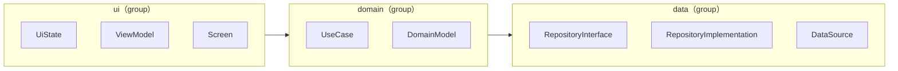

{/*
  このページの目的: Android 公式のアプリアーキテクチャガイド（UI・ドメイン・データ層）を Role と group で宣言し、命名と中身の規約まで検査する例を、コピーして使える形で示すこと。
*/}

import SnippetIsStartingPoint from '../../../../components/SnippetIsStartingPoint.astro';

import { Aside, FileTree, LinkCard, TabItem, Tabs } from '@astrojs/starlight/components';

このページでは、UI・ドメイン・データの3層を group に、ファイルの種類を Role に宣言し、命名と中身まで検査する例を示します。

<LinkCard
  title="アプリ アーキテクチャ ガイド"
  description="Android 公式の推奨アーキテクチャ。UI 層・ドメイン層・データ層の役割と依存の向き。"
  href="https://developer.android.com/topic/architecture"
/>

Android developers で公開されているアプリアーキテクチャガイドは、Android アプリケーションのベースとなるアーキテクチャとして広く知られています。

以下は ドメイン層を採用する場合のアーキテクチャ定義の例です。



図 1. 3層の group と、その中の Role。矢印は依存の向き

## ディレクトリ構造の例

<FileTree>
- app/src/main/kotlin/com/example/project/
  - ui/
    - home/
      - HomeUiState.kt
      - HomeViewModel.kt
      - HomeScreen.kt
  - domain/
    - user/
      - GetUserUseCase.kt
    - model/
      - User.kt
  - data/
    - user/
      - UserRepository.kt
      - UserRepositoryImpl.kt
      - UserRemoteDataSource.kt
</FileTree>

## アーキテクチャ定義

`ProjectArchitecture.kt` に3層の group を、`roles/` 以下に Role ごとのファイルを置きます。

```kt title=ProjectArchitecture.kt nocollapse
@file:OptIn(ExperimentalKatachiApi::class)

import me.tbsten.katachi.ExperimentalKatachiApi
import me.tbsten.katachi.dsl.architecture
import me.tbsten.katachi.dsl.gradle.gradle

/**
 * See https://developer.android.com/topic/architecture
 */
val projectArchitecture = architecture {
  gradle() // wrapper・settings・build スクリプトなど Gradle のファイル

  // https://developer.android.com/topic/architecture/ui-layer
  "ui".group {
    uiState()
    viewModel()
    screen()
  }

  // https://developer.android.com/topic/architecture/domain-layer
  "domain".group {
    useCase()
    domainModel()
  }

  // https://developer.android.com/topic/architecture/data-layer
  "data".group {
    repositoryInterface()
    repositoryImplementation()
    dataSource()
  }
}
```

```kt title=Constants.kt
const val appPackageDir = "com/example/project"
```

<Tabs>
<TabItem label="UiState">

```kt title=roles/UiState.kt
@file:OptIn(ExperimentalKatachiApi::class)

import me.tbsten.katachi.ExperimentalKatachiApi
import me.tbsten.katachi.dsl.DeclarationContainerScope
import me.tbsten.katachi.dsl.gradle.kotlin
import me.tbsten.katachi.dsl.gradle.mainSourceSet
import me.tbsten.katachi.dsl.kotlin.ktFile
import me.tbsten.katachi.konsist.declarations.ktFileContent

fun DeclarationContainerScope.uiState() = "UiState".role {
  summary = "画面が描画に使う状態を、変更されない値として持つ"
  layout {
    "app" / mainSourceSet / kotlin / appPackageDir / "ui/*" / "*UiState".ktFile()
  }

  // HomeUiState.kt には、val のプロパティだけを持つ data class HomeUiState を置く
  ktFileContent {
    `package`(matchingDirectory)
    `import`("**")

    required(data, `class`, fileName) {
      allow(`val`, "*")  // var は許可しないので、書き換えられる状態は違反になる
    }
  }
}
```

</TabItem>
<TabItem label="ViewModel">

```kt title=roles/ViewModel.kt
@file:OptIn(ExperimentalKatachiApi::class)

import me.tbsten.katachi.ExperimentalKatachiApi
import me.tbsten.katachi.dsl.DeclarationContainerScope
import me.tbsten.katachi.dsl.gradle.kotlin
import me.tbsten.katachi.dsl.gradle.mainSourceSet
import me.tbsten.katachi.dsl.kotlin.ktFile
import me.tbsten.katachi.konsist.declarations.ktFileContent

fun DeclarationContainerScope.viewModel() = "ViewModel".role {
  summary = "画面の状態を StateFlow で公開し、画面からのイベントを受け取る"
  layout {
    "app" / mainSourceSet / kotlin / appPackageDir / "ui/*" / "*ViewModel".ktFile()
  }

  // HomeViewModel.kt には、ViewModel を継承した class HomeViewModel だけを置く
  ktFileContent {
    `package`(matchingDirectory)
    `import`("**")

    required(`class`, fileName).superclass("ViewModel") {
      required(public, `val`, "uiState", "StateFlow<${fileName.replace("ViewModel", "UiState")}>")
      allow(public, `fun`, "*")  // 画面からのイベント
      allow(private, anythingElse)  // UseCase や、書き換える側の状態
    }
  }
}
```

</TabItem>
<TabItem label="Screen">

```kt title=roles/Screen.kt
@file:OptIn(ExperimentalKatachiApi::class)

import me.tbsten.katachi.ExperimentalKatachiApi
import me.tbsten.katachi.dsl.DeclarationContainerScope
import me.tbsten.katachi.dsl.gradle.kotlin
import me.tbsten.katachi.dsl.gradle.mainSourceSet
import me.tbsten.katachi.dsl.kotlin.ktFile
import me.tbsten.katachi.konsist.declarations.ktFileContent

fun DeclarationContainerScope.screen() = "Screen".role {
  summary = "画面を描く public な Composable"
  layout {
    "app" / mainSourceSet / kotlin / appPackageDir / "ui/*" / "*Screen".ktFile()
  }

  // HomeScreen.kt で public にするのは @Composable fun HomeScreen だけにする
  ktFileContent {
    `package`(matchingDirectory)
    `import`("**")

    required(annotated("Composable"), public, `fun`, fileName)
    allow(private, anythingElse)  // 画面の部品や Preview など、private なものは何でもよい
  }
}
```

</TabItem>
<TabItem label="UseCase">

```kt title=roles/UseCase.kt
@file:OptIn(ExperimentalKatachiApi::class)

import me.tbsten.katachi.ExperimentalKatachiApi
import me.tbsten.katachi.dsl.DeclarationContainerScope
import me.tbsten.katachi.dsl.gradle.kotlin
import me.tbsten.katachi.dsl.gradle.mainSourceSet
import me.tbsten.katachi.dsl.kotlin.ktFile
import me.tbsten.katachi.konsist.declarations.ktFileContent

fun DeclarationContainerScope.useCase() = "UseCase".role {
  summary = "アプリ固有の1つの振る舞いを invoke で実行する"
  layout {
    "app" / mainSourceSet / kotlin / appPackageDir / "domain/*" / "*UseCase".ktFile()
  }

  // GetUserUseCase.kt には class GetUserUseCase だけを置き、public な関数は invoke だけにする
  ktFileContent {
    `package`(matchingDirectory)  // ディレクトリと同じ package
    `import`("**")

    required(`class`, fileName) {
      required(public, suspend.optional(), operator, `fun`, "invoke")  // suspend は付いていても無くてもよい
      allow(private, anythingElse)  // コンストラクタで受け取る Repository など
    }
  }
}
```

</TabItem>
<TabItem label="DomainModel">

```kt title=roles/DomainModel.kt
@file:OptIn(ExperimentalKatachiApi::class)

import me.tbsten.katachi.ExperimentalKatachiApi
import me.tbsten.katachi.dsl.DeclarationContainerScope
import me.tbsten.katachi.dsl.gradle.kotlin
import me.tbsten.katachi.dsl.gradle.mainSourceSet
import me.tbsten.katachi.dsl.kotlin.ktFile

fun DeclarationContainerScope.domainModel() = "DomainModel".role {
  summary = "ドメイン層で扱う、アプリの概念を表すモデル"
  layout {
    "app" / mainSourceSet / kotlin / appPackageDir / "domain/model" / "*".ktFile()
  }
}
```

</TabItem>
<TabItem label="RepositoryInterface">

```kt title=roles/RepositoryInterface.kt
@file:OptIn(ExperimentalKatachiApi::class)

import me.tbsten.katachi.ExperimentalKatachiApi
import me.tbsten.katachi.dsl.DeclarationContainerScope
import me.tbsten.katachi.dsl.gradle.kotlin
import me.tbsten.katachi.dsl.gradle.mainSourceSet
import me.tbsten.katachi.dsl.kotlin.ktFile
import me.tbsten.katachi.konsist.declarations.ktFileContent

fun DeclarationContainerScope.repositoryInterface() = "RepositoryInterface".role {
  summary = "データの取得と保存の窓口となる interface"
  layout {
    "app" / mainSourceSet / kotlin / appPackageDir / "data/*" / "*Repository".ktFile()
  }

  // UserRepository.kt には interface UserRepository だけを置く
  ktFileContent {
    `package`(matchingDirectory)
    `import`("**")

    required(`interface`, fileName) {
      allow(anythingElse)      // メンバは問わない
    }
  }
}
```

</TabItem>
<TabItem label="RepositoryImplementation">

```kt title=roles/RepositoryImplementation.kt
@file:OptIn(ExperimentalKatachiApi::class)

import me.tbsten.katachi.ExperimentalKatachiApi
import me.tbsten.katachi.dsl.DeclarationContainerScope
import me.tbsten.katachi.dsl.gradle.kotlin
import me.tbsten.katachi.dsl.gradle.mainSourceSet
import me.tbsten.katachi.dsl.kotlin.ktFile
import me.tbsten.katachi.konsist.declarations.ktFileContent

fun DeclarationContainerScope.repositoryImplementation() = "RepositoryImplementation".role {
  summary = "RepositoryInterface の実装"
  layout {
    "app" / mainSourceSet / kotlin / appPackageDir / "data/*" / "*RepositoryImpl".ktFile()
  }

  // UserRepositoryImpl.kt には、UserRepository を実装した class UserRepositoryImpl だけを置く
  ktFileContent {
    `package`(matchingDirectory)
    `import`("**")

    required(`class`, fileName).superclass(fileName.removeSuffix("Impl")) {
      allow(anythingElse)      // メンバは問わない
    }
  }
}
```

</TabItem>
<TabItem label="DataSource">

```kt title=roles/DataSource.kt
@file:OptIn(ExperimentalKatachiApi::class)

import me.tbsten.katachi.ExperimentalKatachiApi
import me.tbsten.katachi.dsl.DeclarationContainerScope
import me.tbsten.katachi.dsl.gradle.kotlin
import me.tbsten.katachi.dsl.gradle.mainSourceSet
import me.tbsten.katachi.dsl.kotlin.ktFile
import me.tbsten.katachi.konsist.declarations.ktFileContent

fun DeclarationContainerScope.dataSource() = "DataSource".role {
  summary = "Repository が使う、データの取得元・保存先へのアクセス"
  layout {
    "app" / mainSourceSet / kotlin / appPackageDir / "data/*" / "*DataSource".ktFile()
  }

  // UserRemoteDataSource.kt には class UserRemoteDataSource だけを置く
  ktFileContent {
    `package`(matchingDirectory)
    `import`("**")

    required(`class`, fileName) {
      allow(anythingElse)      // メンバは問わない
    }
  }
}
```

</TabItem>
</Tabs>

層を group に、ファイルの種類を Role に分けた実際の定義は、[sample/android の ProjectArchitecture.kt](https://github.com/TBSten/katachi/blob/main/sample/android/architecture-test/src/test/kotlin/com/example/sample/ProjectArchitecture.kt) にあります。サンプルはドメイン層を持たず、画面ごとにモジュールを分けた構成なので、このページの定義とは形が違います。

`ktFileContent { }` を使うときは、[ファイルの中で定義できる宣言の許可リストを定義する](/katachi/ja/guides/kt-file-content/#インストール)の設定が要ります。

## AndroidManifest.xml と res/ の Role

3層のどこにも入らない Android のファイルにも Role が要ります。`:app` の `AndroidManifest.xml` は1つしか無いので名前をそのまま書き、`res/` の中の構成は Android のリソースシステムが決めるので `ignore()` にします。次の2つは [sample/android の AndroidManifestRole.kt](https://github.com/TBSten/katachi/blob/main/sample/android/architecture-test/src/test/kotlin/com/example/sample/app/AndroidManifestRole.kt) と [AndroidResourceRole.kt](https://github.com/TBSten/katachi/blob/main/sample/android/architecture-test/src/test/kotlin/com/example/sample/app/AndroidResourceRole.kt) から引用したものです。

```kt {8,20}
// roles/AndroidManifest.kt
import me.tbsten.katachi.dsl.DeclarationContainerScope
import me.tbsten.katachi.dsl.gradle.mainSourceSet

fun DeclarationContainerScope.androidManifest() = "AndroidManifest".role {
  summary = "Android にアプリを宣言する :app の AndroidManifest.xml"
  layout {
    "app" / mainSourceSet / "AndroidManifest.xml".file()
  }
}

// roles/AndroidResource.kt
import me.tbsten.katachi.dsl.DeclarationContainerScope
import me.tbsten.katachi.dsl.gradle.mainSourceSet

fun DeclarationContainerScope.androidResource() = "AndroidResource".role {
  summary = ":app の res/。中の構成は Android のリソースシステムが決める"
  layout {
    // values/ や drawable-*/ の並びは AGP が検査するので、katachi では見ない
    "app" / mainSourceSet / "res".ignore()
  }
}
```

`ProjectArchitecture.kt` では、`"app".group { androidManifest(); androidResource() }` のように `:app` の group に入れます。サンプルでは同じ group に `MainActivity` と `MainApplication` の Role も置いています（[AppGroup.kt](https://github.com/TBSten/katachi/blob/main/sample/android/architecture-test/src/test/kotlin/com/example/sample/app/AppGroup.kt)）。

<SnippetIsStartingPoint>
たとえばプロダクトで Dagger Hilt を使っているなら、ViewModel に `@HiltViewModel` アノテーションが付いているかの検査や、Repository の実装クラスに `@Inject` コンストラクタがあるかの検査を追加するなど、さらにカスタマイズが必要になるでしょう。
</SnippetIsStartingPoint>
