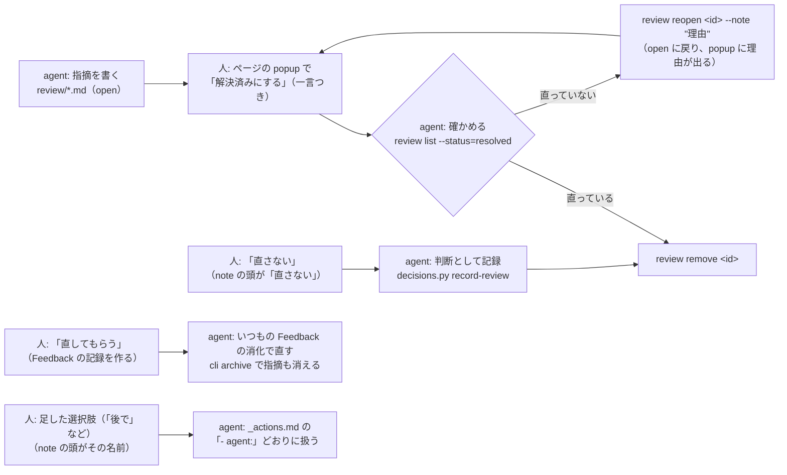

# Review（docs への指摘を、ページの上に印と popup で出す）

`astro dev` のときだけ使える toolbar アプリ。Feedback・Memo の隣の「Review」を押すと、今のページへの指摘が
本文の横の番号の印と枠で出て、印を押すと popup で読める。既定は隠したまま。出しているあいだはタブの中で覚えていて、
ページを移っても出し続ける（もう一度押すか、一覧の × で隠す）。本番ビルドには出ない（`scripts/check-no-dev-tools-in-dist.sh`）。

## 流れ



## 置き場

`<置き場>/review/<名前>.md`。置き場は `KATACHI_FEEDBACK_DIR`、無ければリポジトリ直下の `.local/feedback/`（git に入らない）。
1 ファイルが指摘のまとまり 1 つ（例: `prerelease-261109-01.md`）。名前は英数字・`.`・`_`・`-` だけ。
ファイルは開くたび（とタブに戻ったとき）に読み直すので、dev サーバーを立て直す必要は無い。

## 形

```md
---
title: v0.4.0 リリース前チェック 手順 11
base: 1a7a072
---

## [p3] dsl.gradle を個別 import している
- file: ja/get-started/first-architecture.mdx
- line: 168
- quote: import me.tbsten.katachi.dsl.gradle.gradle

本文（Markdown）。箇条書き・`code`・**太字**・[リンク](https://…)・コードフェンス・引用が使える。
- 該当: …
- 直し方の案: …
```

- frontmatter は省略できる。`title` は一覧と popup の場所の表示に、`base` は「行番号を数えたコミット」の表示に使う。
- 指摘 1 件は `## ` の見出しから次の `## ` の手前まで（コードフェンスの中の `## ` は見出しにしない）。
- 見出しの先頭の `[pN]` が優先度（0〜。p7 以上は赤、p5〜6 は橙、p3〜4 は黄、それ未満は灰、無ければ藍）。`- priority: N` でもよい。
- 見出しの直後に続く次のキーだけがメタ。ほかの行（`- 該当: …` など）は本文になる。
- 1 件が指す場所は 1 か所。いくつかのページ・行にまたがる指摘（「motivation L327・faq L140」「4 ページとも」など）は、場所ごとに 1 件ずつ書く（見出しをそろえ、本文に「同じ指摘: faq.mdx L140」と添える）。人は場所ごとに直して解決済みにする。

| キー | 中身 |
|---|---|
| `file` | 必須。リポジトリ直下からのパス。docs の本文は `docs/src/content/docs/` を省いて `ja/guides/role.mdx` と書いてよい。ページの無いファイル（`README.ja.md` など）も書ける（一覧の「ページの無いファイル」に出る） |
| `line` | `168` / `160-186` / `L160〜L186`。無ければページ全体への指摘。ページ全体と、本文に出ない行（frontmatter の description・MDX のコメントなど）への指摘は、印をページの見出しに出す。タブの見出し（`<TabItem label="…">`）や `<LinkCard>` の title・description の行は、その文字をページから探して印を出す |
| `quote` | その行に含まれる文字列。指摘を書いたあとで行がずれても、いちばん近い quote の行へ動かして出す。`…`・`...` は省略とみなす。line が無く quote だけなら、quote を含む最初の行に出す。範囲の指摘は先頭の行の文字列を書く |
| `status` | `open`（既定）/ `resolved`。popup の「解決済みにする」が書く |
| `resolved-at` / `note` | 解決済みにした時刻と、人の一言。popup が書く |
| `ai-note` | agent の一言（差し戻しの理由）。`review reopen` が書く。popup に「agent から」として出る |
| `id` | 指摘の id を固定する（まとまりの名前を除いた形。`k3x9a2b-2`）。同じ file・見出しの指摘がほかにもあるとき、popup で印を付け外しすると書く。手では書かない |

行は今のソースに合わせて出す。quote が見つからない指摘は書かれた行のまま出し、popup に「もう直っているかもしれません」と出す。

## cli

```sh
C=docs/src/integrations/feedback/server/cli.mjs
node $C review list [--status=open|resolved|all] [--json]   # 一覧（id・状態・優先度・今の行・見出し・一言）
node $C review show <id>                                    # 1 件の全部（ページで開くリンク `…/#review=<id>` も出す）
node $C review check                                        # 読めない指摘・無いファイル・quote が見つからない行。問題があれば 1 で終わる
node $C review remove <id>                                  # 確かめた指摘を消す（解決済みのものだけ。未解決も消すなら --force）
node $C review reopen <id> --note "<理由>"                  # 解決済みを差し戻す
node $C review list --status=resolved --action=後で          # 押したボタン（直さない・直してもらう・足した選択肢）で絞る
node $C review actions [--json]                             # 人が足した選択肢と、選ばれた指摘を agent がどう扱うか
```

id は `<まとまりの名前>/<file と見出しから作る 7 文字>`。ほかの指摘を消しても変わらない（見出しか file を書き換えると変わる）。
同じ file・見出しの指摘が並ぶと、2 件目から `-2`・`-3` が付く。この番号は並び順なので、popup で解決済みにした時点で `- id:` をメタに書いて固定する
（Feedback の記録や判断の記録が id で指している指摘が、前の指摘を消したときに `x-2` から `x` へずれないように）。

## 画面

- 一覧（右上。スマホは畳むと右上の札、開くと下）: このページの指摘・ほかのページの件数・ページの無いファイル・読めない指摘。優先度で絞る・解決済みも出す。
- 印を押す・一覧の行を押す → popup。前・次（ページをまたぐときは、そのページへ移ってから開く）、← → でも動く、Esc と × で閉じる（選択肢の編集中の Esc は編集だけを閉じる）。右下に「何件め / 総数」（絞り込み後の全体）。
- 閉じた details・選ばれていないタブ・畳んだコードブロック（Show more）の中の指摘は、開くときに見えるようにする。コードブロックの中は 1 行ずつ光らせる。
- popup を開いたまま docs を直すと（Astro がページを読み直す）、同じ指摘を開き直す。quote で今の行を探し直すので、直して quote が消えれば「もう直っているかもしれません」と出る。
- `<ページ>#review=<id>` のリンクで開くと、隠していても出してその指摘を開く（人に 1 件を見てもらうときに渡す）。
- popup の上の「L174 faq.mdx」を押すと `file:line` をコピー、「開く」でエディタのその行を開く（Astro の dev サーバーの「エディタで開く」。エディタは `LAUNCH_EDITOR` などで選ぶ）。
- 「解決済みにする」は次の指摘へ進む（トーストの「戻す」で取り消せる）。次がほかのページの指摘なら、ページは移らずに閉じ、トーストの「次のページ ›」で移る。保存中と進んだ直後は押せない（連打で次の指摘まで解決済みにしない）。
- 「直さない」は直さないと決めた指摘を解決済みにする。`note` の頭に `直さない`（ひとことがあれば `直さない: <ひとこと>`）と書く。agent は直ったかを確かめずに `review remove` してよい。
  ただし remove の前に、判断として `.claude/skills/prerelease/decisions/` に写す（`python3 .claude/skills/prerelease/scripts/decisions.py record-review <置き場>/review/<名前>.md --decided "<日付 回 チケット>"`。写した指摘の id が `REMOVE <id>` で出る）。写さずに消すと、次のリリース前チェックで同じ指摘をまた聞くことになる。
- 「直してもらう」は、指摘を Feedback の記録（`<置き場>/yymmdd-NNN.md`）にして agent に直してもらう。記録の本文は「直してほしい: <見出し>」・ひとこと・指摘の本文で、ソースの行と `- Review の指摘: <id>` が入る。指摘は解決済みになり、`note` の頭に `Feedback に送った: <記録の id>` と書く。トーストの「戻す」で記録を archive し、指摘を未解決に戻す。
  - agent は `note` の頭が `Feedback に送った` の指摘を Review の流れ（`review list --status=resolved` で確かめる）で扱わない。記録をいつもの Feedback の消化で直し、`cli.mjs archive <記録の id>` で archive すると、`- Review の指摘:` の指摘も消える

## 選択肢を足す

popup の「直さない」「直してもらう」「解決済みにする」のほかに、人が選択肢を足せる（「後で」「このまま」「PR #65 待ち」など）。
足した選択肢は点線の枠のボタンで並び、押すと指摘を解決済みにして、`note` の頭にその名前を書く（`後で` / `後で: <ひとこと>`）。「直さない」と同じ形。

- popup の「＋」で足す・消す（名前・agent にしてほしいこと・判断の記録の種類）。消してもトーストの「戻す」で足し直せる。
- 置き場は `<置き場>/review/_actions.md`（git に入らない。`_` で始まるので指摘のまとまりとしては読まない）。手で書いてもよい。

```md
# Review の選択肢

## 後で
- agent: v0.5 のチケットに積んでから review remove する
- decision: 後で

## PR #65 待ち
- agent: PR #65 のマージ後に見直し、指摘の箇所が消えていれば review remove、残っていれば review reopen
```

| キー | 中身 |
|---|---|
| 見出し | ボタンの名前で、`note` の頭に書く文字。20 文字まで。`:` は使えない（`名前: ひとこと` の区切り）。初めからのボタンの名前（直さない・直してもらう・解決済みにする）と `Feedback に送った` も使えない |
| `agent` | 選ばれた指摘を agent がどう扱うか。ボタンの説明と `review actions` に出る |
| `decision` | prerelease の判断の記録（`.claude/skills/prerelease/decisions/`）に写すときの種類。`直さない` / `このまま` / `後で` / `方針` |

- 手で付けた note の `名前（理由）`・`名前 理由` も、その名前で解決済みにしたものとして読む（`review list --action`・一覧の札・`decisions.py record-review`）。
- 8 個まで。見出しの直後に続く `- agent:` / `- decision:` だけを読み、ほかの行はメモとして読み飛ばす。読めない行は一覧の「読めない指摘・ファイル」と `review check` に出る。
- agent は `review list --status=resolved` の一言の頭を見て、`review actions` の `agent` どおりに扱う。`agent` が書かれていない選択肢は人に聞く。
- `decision` の付いた選択肢で解決済みにした指摘は、「直さない」と同じく `decisions.py record-review` が判断として写す（`review remove` の前に）。
